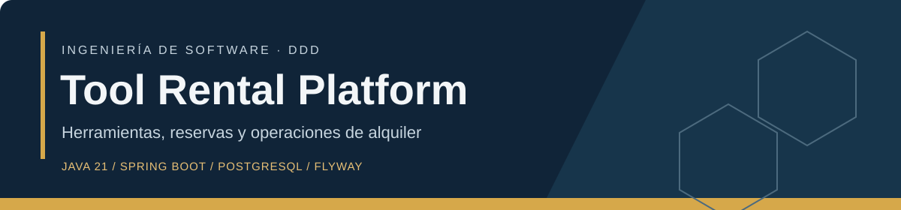
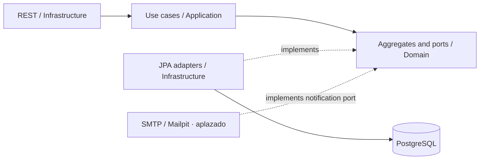
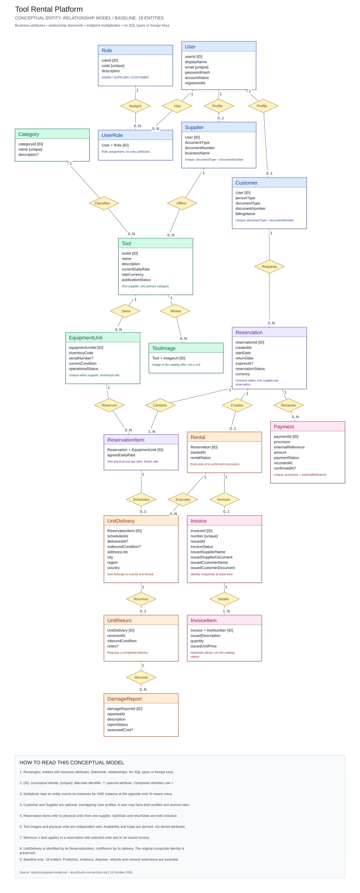

<div align="center">



**Backend de alquiler de herramientas con arquitectura hexagonal, DDD y seguridad orientada a producción.**

[Inicio](#inicio-rápido) · [Arquitectura](#arquitectura) · [Seguridad](#seguridad) · [Negocio](#reglas-críticas-de-negocio) · [API](#api-rest) · [Documentación](#documentación)

</div>

---

## Entrega MVP de Daniel/Mayorga

**Estado: integrado, ejecutándose y validado localmente; publicación pública pendiente.** Accede a la composición aislada en http://localhost:15173 después de seguir [despliegue](docs/deployment.md). No hay una demo pública acreditada todavía. El cierre compartido y las dependencias de Conde están en [el MVP](docs/mvp.md).

[Despliegue reproducible](docs/deployment.md) · [Contratos por rol](docs/integration-contracts.md) · [Modelo relacional y físico](docs/logical-physical-model.md) · [Evidencias](docs/validation-report.md)


## Estado actual

El proyecto usa Java 21, Spring Boot 3.5.16, PostgreSQL y Flyway. Los tres módulos Maven conservan las dependencias hacia dentro: `infrastructure → application → domain`. El modelo contiene **25 tablas y 25 contextos organizativos**; las transacciones coordinan las reglas que atraviesan reservas, pagos, sesiones, devoluciones y reembolsos.

| Área | Implementado | Fuera de este alcance |
| --- | --- | --- |
| Identidad | BCrypt, JWT de acceso, sesiones rotativas, revocación y CSRF; recuperación deshabilitada en el MVP | MFA y proveedores de identidad externos |
| Reservas | Retención atómica con vencimiento, confirmación automática, cancelación, entrega, devolución, extensión y mora | Optimización logística avanzada |
| Dinero | Mercado Pago Checkout Pro en COP, conciliación, comprobante académico y reembolso tardío; aceptación externa pendiente | Cobros reales, PayPal e impuestos definitivos |
| Reportes | Ingresos, demanda, clientes, disponibilidad y rentabilidad con alcance por rol | Margen contable hasta modelar costos operativos |
| Entrega | Recogida gratuita o entrega del proveedor en Colombia | Tarifas geográficas y transportadoras externas |
| Persistencia | JPA, PostgreSQL, Flyway hasta V304 y datos demo separados | Operación administrada de respaldos y alta disponibilidad |
| API | `/api/v1`, OpenAPI, `ProblemDetail` y alias temporal `/api` | Eliminación futura del alias heredado |

El [enunciado original](ejercicioDemo.md) se conserva sin cambios. PostgreSQL reemplaza a MySQL por decisión autorizada.

## Inicio rápido

Requisitos: JDK 21, PostgreSQL y Docker cuando se quiera ejecutar la suite Testcontainers.

```powershell
$env:JAVA_HOME = 'C:\ruta\al\jdk-21'
.\mvnw.cmd -version
.\mvnw.cmd clean verify
docker compose config --quiet
docker compose up --build
```

Compose levanta PostgreSQL, backend y frontend. Mailpit se conserva como herramienta de desarrollo para una entrega futura; correo y recuperación están deshabilitados en el MVP. El backend queda en `http://localhost:8080`; la página raíz ejecuta una consulta JDBC real y muestra si la conexión fue exitosa.

### Entorno demostrativo

El perfil `demo` carga un catálogo aislado de 30 herramientas publicadas, 20 herramientas históricas sin publicar y tres cuentas locales. No debe activarse sobre una base productiva.

```powershell
$env:SPRING_PROFILES_ACTIVE = 'local,demo'
$env:VITE_DEMO_MODE = 'true'
$env:POSTGRES_PASSWORD = 'tool_rental_local_2026'
docker compose up --build
```

| Rol | Correo | Contraseña | Acceso esperado |
| --- | --- | --- | --- |
| Cliente | `cliente@toolrental.local` | `ToolRental2026!` | Catálogo, cotización, reservas y cuenta |
| Proveedor | `proveedor@toolrental.local` | `ToolRental2026!` | Panel y publicaciones propias |
| Administrador | `admin@toolrental.local` | `ToolRental2026!` | Panel y recursos administrativos |

Estas credenciales existen únicamente en las migraciones `db/demo`; no son usuarios predeterminados de producción.

Para ejecutar sin Compose:

```powershell
$env:SPRING_PROFILES_ACTIVE = 'production'
$env:DB_URL = 'jdbc:postgresql://localhost:5432/tool_rental'
$env:DB_USERNAME = 'tool_rental'
$env:DB_PASSWORD = '<secret>'
$env:JWT_SECRET = '<mínimo-32-bytes>'
$env:MERCADOPAGO_ACCESS_TOKEN = '<private-test-seller-token>'
$env:MERCADOPAGO_COLLECTOR_ID = '<test-seller-id>'
$env:MERCADOPAGO_WEBHOOK_SECRET = '<private-webhook-secret>'
$env:PAYMENTS_PUBLIC_URL = 'https://app.example'
$env:CORS_ALLOWED_ORIGINS = 'https://app.example'
.\mvnw.cmd -pl infrastructure -am spring-boot:run
```

No actives los perfiles `local,demo` sobre datos reales. Las credenciales se suministran mediante variables o un gestor de secretos.

## Arquitectura



Los módulos Domain y Application no importan Spring, Hibernate ni HTTP. Infrastructure contiene controladores, seguridad, entidades JPA, mappers, repositorios Spring Data y configuración.

<details>
<summary><strong>Ver los 25 contextos y tablas</strong></summary>

| Contexto | Tabla | Contexto | Tabla |
| --- | --- | --- | --- |
| `user` | `users` | `role` | `roles` |
| `userrole` | `user_roles` | `customer` | `customers` |
| `supplier` | `suppliers` | `category` | `categories` |
| `tool` | `tools` | `toolimage` | `tool_images` |
| `equipmentunit` | `equipment_units` | `reservation` | `reservations` |
| `reservationitem` | `reservation_items` | `rental` | `rentals` |
| `unitdelivery` | `unit_deliveries` | `unitreturn` | `unit_returns` |
| `damagereport` | `damage_reports` | `payment` | `payments` |
| `invoice` | `invoices` | `invoiceitem` | `invoice_items` |
| `usersession` | `user_sessions` | `passwordreset` | `password_reset_tokens` |
| `cancellationpolicy` | `cancellation_policies` | `reservationtermination` | `reservation_terminations` |
| `deliveryrate` | `delivery_rates` | `reservationextension` | `reservation_extensions` |
| `refund` | `refunds` |  |  |

</details>

Consulta [arquitectura](docs/backend-architecture.md) y [mapa de paquetes](docs/source-package-map.md).

## Seguridad

- JWT de acceso con `sid` y vigencia predeterminada de 15 minutos. React debe conservarlo únicamente en memoria.
- Refresh token opaco de 256 bits, guardado como hash, con vigencia de 30 días y rotación atómica.
- La reutilización fuera del margen de 10 segundos compromete y revoca toda la familia.
- El refresh vive en cookie `HttpOnly`, ruta `/api`, `SameSite=Lax` y `Secure` en producción.
- Renovación y cierres de sesión exigen cookie CSRF y cabecera `X-XSRF-TOKEN`.
- Cambio de contraseña, cambio de roles y desactivación revocan sesiones activas.
- Recuperación y restablecimiento quedan deshabilitados y ocultos en el MVP; el código opaco de un uso se conserva para una entrega futura. No se exige SMTP.
- CORS con credenciales acepta únicamente los orígenes configurados.
- Los errores usan `application/problem+json` con `code`, `status`, `detail`, `instance` y `traceId`.

## Reglas críticas de negocio

- Una reserva pendiente se cancela sin cargo.
- Una reserva confirmada cancelada con 48 horas exactas o más recibe reembolso completo; por debajo del límite se cobra 25 %.
- La inasistencia puede declararse dos horas después de la hora programada y cobra 50 %.
- El retracto queda en revisión administrativa. Aprobación: cancelación y reembolso completo. Rechazo: vuelve al estado confirmado.
- Un alquiler ya iniciado bloquea cancelación comercial, inasistencia y retracto.
- Los reembolsos se calculan a partir de pagos confirmados y se registran **pendientes**, con idempotencia; no se marcan como transferidos sin pasarela externa. Si el cargo supera lo pagado se crea un ajuste pendiente.
- `CUSTOMER_PICKUP` cuesta cero. `SUPPLIER_DELIVERY` usa una tarifa COP global, versionada, y una dirección en Colombia.
- Las extensiones conservan la fecha original, actualizan la fecha efectiva, comprueban disponibilidad y usan tarifas congeladas.
- La mora se calcula por día calendario iniciado en la zona `America/Bogota` y se registra como ajuste.

## API REST

El contrato oficial empieza por `/api/v1`. El alias `/api` permanece temporalmente y responde con `Deprecation: true` y un enlace a la ruta sucesora. Swagger solo publica rutas versionadas.

Rutas principales:

- `GET /api/v1/auth/csrf`, `POST /auth/refresh`, `/logout` y `/logout-all`.
- `GET /api/v1/auth/sessions` y `DELETE /auth/sessions/{id}`.
- `GET /api/v1/public/features`: capacidades vigentes; recuperación deshabilitada.
- `POST /api/v1/auth/supplier-registration` y activación administrativa del usuario.
- `POST /api/v1/payments/checkouts`, checkout oficial alojado, webhook Mercado Pago y descarga del comprobante académico.
- `GET /api/v1/reports/{income|most-rented-tools|frequent-customers|availability|profitability}`.
- `POST /api/v1/reservation-terminations/reservations/{id}/cancellation`, `/no-show`, `/withdrawal`, `/external-review` y `/supplier-failure`.
- `POST /api/v1/reservation-extensions/reservations/{id}` y resolución por aprobación o rechazo.
- `GET|POST /api/v1/commercial-configuration/delivery-rates` y `/cancellation-policies` para administración.
- `GET /api/v1/refunds/payments/{id}` y consulta normal de pagos para ajustes.

La especificación está en `http://localhost:8080/v3/api-docs` y Swagger UI en `http://localhost:8080/swagger-ui.html`. Consulta [contratos REST](docs/rest-api.md).

## Migraciones y validación

El historial previo hasta V200 se conserva sin reescritura. Las migraciones aditivas V201–V210 agregan sesiones, recuperación, políticas, terminaciones, tarifa de entrega, extensiones, reembolsos, campos operativos y retenciones/pagos completos. `db/demo/V300–V302` carga políticas, cuentas, catálogo y escenarios históricos académicos. V303 se reserva a showcase y desactiva credenciales conocidas. V304 añade la orquestación del checkout oficial en payments.

Consulta [pagos del MVP](docs/mercadopago-mvp.md): configuración privada, retorno, conciliación y aceptación externa pendiente. PayPal y correo están aplazados por decisión de alcance.

Hibernate usa `ddl-auto: validate`; Flyway tiene `clean` deshabilitado. Nunca edites una migración aplicada. Revisa [migraciones](docs/database-migrations.md), [compilación](docs/build-and-test.md) y el [reporte de validación](docs/validation-report.md).

## Modelo conceptual

La ilustración conservada es anterior a V210: la factura actualmente pertenece a la reserva y puede preceder al alquiler. Consulta el [modelo relacional vigente y el DDL físico](docs/logical-physical-model.md) para las claves actuales.



[Abrir SVG](docs/diagrams/conceptual-er-model.svg) · [Editar en Excalidraw](docs/diagrams/conceptual-er-model.excalidraw) · [Modelo explicado](docs/conceptual-model.md) · [Normalización 4FN](docs/fourth-normal-form.md)

## Documentación

| Tema | Documento |
| --- | --- |
| Arquitectura y paquetes | [backend-architecture.md](docs/backend-architecture.md) · [source-package-map.md](docs/source-package-map.md) · [Guía de desarrollo](docs/development-guide.md) |
| API y seguridad | [rest-api.md](docs/rest-api.md) · [production-readiness.md](docs/production-readiness.md) |
| Modelo y datos | [conceptual-model.md](docs/conceptual-model.md) · [fourth-normal-form.md](docs/fourth-normal-form.md) · [data-sources.md](docs/data-sources.md) |
| Alcance y cobertura | [product-scope.md](docs/product-scope.md) · [requirements-coverage.md](docs/requirements-coverage.md) · [pendientes.md](docs/pendientes.md) |
| Operación | [deployment.md](docs/deployment.md) · [build-and-test.md](docs/build-and-test.md) · [database-migrations.md](docs/database-migrations.md) |
| Rendimiento y accesibilidad del frontend | [Auditoría, mediciones y pruebas](docs/frontend-quality.md) |
| Condiciones | [terms-and-conditions.md](docs/terms-and-conditions.md) |

Los nombres de código y commits se mantienen en inglés. La documentación para el equipo se conserva en español.
