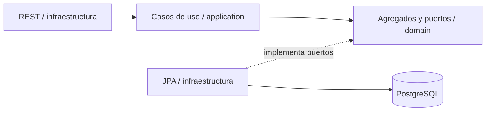

<div align="center">


**Backend modular con reglas de negocio independientes y persistencia verificable.**

[Primeros pasos](#primeros-pasos) · [Arquitectura](#arquitectura) · [Modelo conceptual](#modelo-conceptual) · [Migraciones](#migraciones) · [Documentación](#documentación)

</div>

---

## Propósito y estado

Gestionar el catálogo de proveedores, reservar equipos físicos y registrar el ciclo de alquiler: entrega, devolución, daños, pagos y facturas. El backend conserva tres módulos Maven y 18 contextos organizados por tabla, con transacciones coordinadas para proteger las reglas entre contextos.

| Área | Implementación actual | Límite de esta entrega |
| --- | --- | --- |
| Dominio y aplicación | Catálogo, identidad y operaciones de los 18 contextos | Reglas comerciales pendientes registradas explícitamente |
| Persistencia | JPA, Flyway, restricciones y confirmación concurrente en PostgreSQL | Sin generación automática de esquema |
| REST | Contratos, validación, permisos y errores HTTP | Falta implementar autenticación JWT; las peticiones anónimas reciben 401 |
| Facturación y pagos | Facturas con instantáneas; pagos administrativos | Sin pasarela, liquidación fiscal ni reembolso externo |
| Web | Estado real de conexión en 8080 y base React separada | Recorridos de negocio del frontend pendientes |
| Operación | JAR, Dockerfiles, Compose y guías | Preparación de producción en curso |

> [!IMPORTANT]
> La autenticación todavía no emite ni verifica tokens. Antes de exponer el servicio revisa los [criterios de salida a producción](docs/production-readiness.md) y la [cobertura de la rúbrica](docs/requirements-coverage.md).

## Tecnologías

| Responsabilidad | Tecnología |
| --- | --- |
| Lenguaje y plataforma | Java 21 · Spring Boot 3.5.16 |
| Construcción | Maven Wrapper 3.9.9 · reactor de tres módulos |
| Datos | PostgreSQL · Spring Data JPA · Hibernate · Flyway |
| Verificación | JUnit · Spring Boot Test · ArchUnit · Testcontainers · Spotless |
| Interfaz separada | React · JavaScript · Vite · Nginx |

PostgreSQL reemplaza a MySQL por decisión autorizada. El [enunciado original](ejercicioDemo.md) se conserva sin modificaciones.

## Primeros pasos

Necesitas JDK 21 y PostgreSQL. Las pruebas usan Docker/Testcontainers por defecto; también admiten una base PostgreSQL exclusiva para pruebas. Node.js 24 se necesita para desarrollar el frontend, no para ejecutar el JAR.

### 1. Seleccionar JDK 21 y verificar

```powershell
$env:JAVA_HOME = 'C:\Users\danie\scoop\apps\temurin21-jdk\current'
& "$env:JAVA_HOME/bin/java.exe" -version
.\mvnw.cmd -version
.\mvnw.cmd clean verify
```

Adapta la ruta del JDK a tu instalación. En este equipo `java` en el PATH todavía puede resolver Java 17: usa explícitamente el ejecutable de `JAVA_HOME`. En Linux/macOS utiliza `./mvnw`. La [guía de compilación](docs/build-and-test.md) explica la alternativa sin Docker y los fallos LF/CRLF.

### 2. Configurar y arrancar el backend

```powershell
$env:SPRING_PROFILES_ACTIVE = 'production'
$env:DB_URL = 'jdbc:postgresql://localhost:5432/tool_rental'
$env:DB_USERNAME = 'tool_rental'
# Define DB_PASSWORD fuera del repositorio mediante tu gestor de secretos o entorno.
& "$env:JAVA_HOME/bin/java.exe" -jar infrastructure/target/infrastructure-0.1.0-SNAPSHOT.jar
```

El perfil `production` exige las tres variables de conexión. También existe `local`, con configuración en `application-local.yml`; tus credenciales privadas no deben publicarse. No actives `demo` sobre datos reales.

### 3. Comprobar la conexión

Abre **[localhost:8080](http://localhost:8080)**. La página muestra «Conexión a la base de datos exitosa.» solo después de una consulta JDBC real. `GET /status/database` devuelve 200 o 503; las rutas `/api/**` mantienen su requisito de `Principal` autenticado.

Para contenedores y frontend consulta [despliegue](docs/deployment.md) y [compilación](docs/build-and-test.md).

## Arquitectura



```text
domain/          Agregados, objetos de valor, eventos y puertos
application/     Comandos, respuestas, excepciones y casos de uso
infrastructure/  REST, JPA, configuración Spring y migraciones
frontend/        Base React independiente
docs/            Modelo, normalización, operación y decisiones
```

Las dependencias Maven apuntan hacia dentro: `infrastructure → application → domain`. Una tabla por contexto es una convención de este proyecto; los detalles de reservas y facturas siguen sujetos a las transacciones de sus propietarios.

<details>
<summary><strong>Ver los 18 contextos y sus tablas</strong></summary>

| Contexto | Tabla | Contexto | Tabla |
| --- | --- | --- | --- |
| `user` | `users` | `reservation` | `reservations` |
| `role` | `roles` | `reservationitem` | `reservation_items` |
| `userrole` | `user_roles` | `rental` | `rentals` |
| `customer` | `customers` | `unitdelivery` | `unit_deliveries` |
| `supplier` | `suppliers` | `unitreturn` | `unit_returns` |
| `category` | `categories` | `damagereport` | `damage_reports` |
| `tool` | `tools` | `payment` | `payments` |
| `toolimage` | `tool_images` | `invoice` | `invoices` |
| `equipmentunit` | `equipment_units` | `invoiceitem` | `invoice_items` |

</details>

Consulta la [arquitectura detallada](docs/backend-architecture.md), el [mapa de paquetes](docs/source-package-map.md) y los [contratos REST](docs/rest-api.md).

## Modelo conceptual


[Ampliar SVG](docs/diagrams/conceptual-er-model.svg) · [Editar en Excalidraw](docs/diagrams/conceptual-er-model.excalidraw) · [Modelo explicado](docs/conceptual-model.md) · [Normalización hasta 4FN](docs/fourth-normal-form.md)

Las reservas contienen unidades distintas de un proveedor y usan fechas inclusivas: del 14 al 15 son dos días. Las solicitudes pendientes no bloquean unidades; confirmar valida disponibilidad atómicamente y congela tarifas. Las facturas conservan sus datos históricos. Las imágenes de una herramienta y sus unidades físicas son conjuntos independientes.

## Migraciones

Las migraciones desarrolladas por **Conde** están integradas en Flyway como **V4–V24**, respetando V1–V3 ya aplicadas en la base de Daniel. Se conserva su procedencia y se adaptan las creaciones para reconocer objetos existentes. Esto mantiene el historial sin recrear las 18 tablas ni modificar checksums anteriores.

| Ubicación | Contenido | Activación |
| --- | --- | --- |
| [`db/migration`](infrastructure/src/main/resources/db/migration) | 24 versiones estructurales y de roles | Todos los perfiles |
| [`db/demo`](infrastructure/src/main/resources/db/demo) | 18 versiones V101–V118 con datos ficticios | Solo perfil adicional `demo` |

Hibernate utiliza `ddl-auto: validate`; Flyway valida historial, no establece baselines automáticos y tiene `clean` deshabilitado. Consulta la [trazabilidad y el procedimiento de actualización](docs/database-migrations.md).

## Validación

La entrega se comprueba con PostgreSQL real: arranque desde cero, actualización desde V3 conservando datos/checksums, mapeo de 18 entidades, restricciones, rollback, tarifas congeladas y confirmaciones concurrentes. Los datos demo se prueban en un esquema separado.

El [reporte de validación](docs/validation-report.md) registra resultados y límites. Verificar la configuración de Compose no equivale a haber ejecutado sus contenedores ni a validar producción.

## Documentación

| Necesidad | Documento |
| --- | --- |
| Compilar, probar y corregir formato | [Compilación y pruebas](docs/build-and-test.md) |
| Ejecutar JAR o Docker | [Despliegue](docs/deployment.md) |
| Evolucionar y respaldar datos | [Migraciones y aportes de Conde](docs/database-migrations.md) |
| Revisar la rúbrica | [Matriz de cobertura](docs/requirements-coverage.md) |
| Preparar producción | [Criterios de publicación](docs/production-readiness.md) |
| Extender el backend | [Guía de desarrollo](docs/development-guide.md) |
| Revisar negocio y alcance | [Alcance aprobado](docs/product-scope.md) · [Hoja de ruta](docs/pendientes.md) |
| Consultar historial de integración | [Comparación de ramas](docs/branch-merge-report.md) |
| Revisar datos y documentos pendientes | [Fuentes demo](docs/data-sources.md) · [Pendientes de datos](docs/pendientes-base-datos.md) · [Borrador de términos](docs/terms-and-conditions.md) |

La estructura documental utiliza las skills [create-readme](https://skills.sh/github/awesome-copilot/create-readme) y [readme-blueprint-generator](https://skills.sh/github/awesome-copilot/readme-blueprint-generator), instaladas en [`.agents/skills`](.agents/skills). El [registro de herramientas](docs/documentation-tooling.md) identifica su origen y aplicación.

Los commits conservan el formato en inglés: `feat: :card_file_box: IntegrateCondeForwardMigrations`.
