<div align="center">

> Verificación actual: [herramientas, fotografías y persistencia por roles](docs/provider-persistence.md). El [reporte del merge](docs/integration-review.md) conserva la línea base anterior.


**Backend de alquiler de herramientas con arquitectura hexagonal, DDD y seguridad orientada a producción.**

[Inicio](#inicio-rápido) · [Arquitectura](#arquitectura) · [Seguridad](#seguridad) · [Negocio](#reglas-críticas-de-negocio) · [API](#api-rest) · [Documentación](#documentación)

</div>

---

## Gestión del proveedor y persistencia

**Dashboard integrado al header:** al iniciar sesión, proveedor y administrador navegan sus secciones desde el encabezado, también en móvil; el cliente conserva catálogo y cuenta. El login valida formato, controles invisibles y límites de BCrypt sin eliminar símbolos válidos de las contraseñas. [Integración, seguridad y evidencias por rol](docs/header-integration.md).

La carga inicial muestra una cinta métrica con el texto **Tomando medidas** durante al menos cuatro segundos y después revela la interfaz. Respeta la preferencia de movimiento reducido y no se repite al navegar internamente. [Reglas visuales y transición](docs/DESIGN.md#pantalla-de-carga-inicial).

**Actualización del recorrido proveedor → cliente:** el formulario registra también las unidades físicas indicadas; el panel confirma el ID guardado y ofrece **Ver en catálogo** y **Agregar existencias**. El catálogo muestra todas las coincidencias por defecto y oculta inicialmente las herramientas sin unidades operativas. [Uso y validación crítica](docs/provider-persistence.md#publicación-lista-para-alquilar).

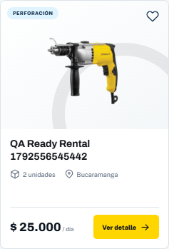

La web local se abre en **http://localhost:5173** y utiliza PostgreSQL Docker en **localhost:5433**. El perfil `local,demo` carga el seed automáticamente en instalaciones vacías. Se corrigieron el límite de precio implícito del catálogo y la actualización de publicaciones; en el equipo de Daniel, DBeaver ya tiene la conexión **Tool Rental - Docker 5433**. [Inicio local, consultas y diagnóstico](docs/provider-persistence.md#base-estable-y-dbeaver).


```powershell
docker compose up --build -d
node scripts/verify-local-catalog.mjs
```

El proveedor puede crear y editar herramientas, publicar/retirar, adjuntar fotos mediante archivos o URLs y administrar unidades físicas. Se verificaron **67 comprobaciones con navegador y PostgreSQL reales**, además de restauración conjunta de datos e imágenes y recreación de contenedores. [Procedimiento, límites y evidencias](docs/provider-persistence.md).


## Entrega MVP de Daniel/Mayorga

**Estado: integrado, ejecutándose y validado localmente; publicación pública pendiente.** Accede a la composición aislada en http://localhost:15173 después de seguir [despliegue](docs/deployment.md). No hay una demo pública acreditada todavía. El cierre compartido y las dependencias de Conde están en [el MVP](docs/mvp.md).

[Despliegue reproducible](docs/deployment.md) · [Contratos por rol](docs/integration-contracts.md) · [Modelo relacional y físico](docs/logical-physical-model.md) · [Evidencias](docs/validation-report.md)


## Pruebas del sistema: Swagger, Insomnia y Tomcat

**Entrega verificada localmente:** Swagger documenta 123 operaciones en 92 rutas, con ejemplos JSON e instrucciones JWT. Una colección de Insomnia ejecutada mediante **Inso CLI** aprobó **41 peticiones y 61 comprobaciones** contra PostgreSQL aislado: CRUD, permisos, sesiones, pago ficticio aprobado/rechazado y alquiler hasta devolución. Apache Tomcat **10.1.55** está integrado en Spring Boot y se ejecuta con Java 21.

[Procedimiento y alcance](docs/system-tests.md) · [Colección importable en Insomnia](docs/insomnia/system-tests.json) · [Resultados](docs/evidence/system-tests/insomnia.json) · [Swagger local](http://localhost:8080/swagger-ui/index.html)

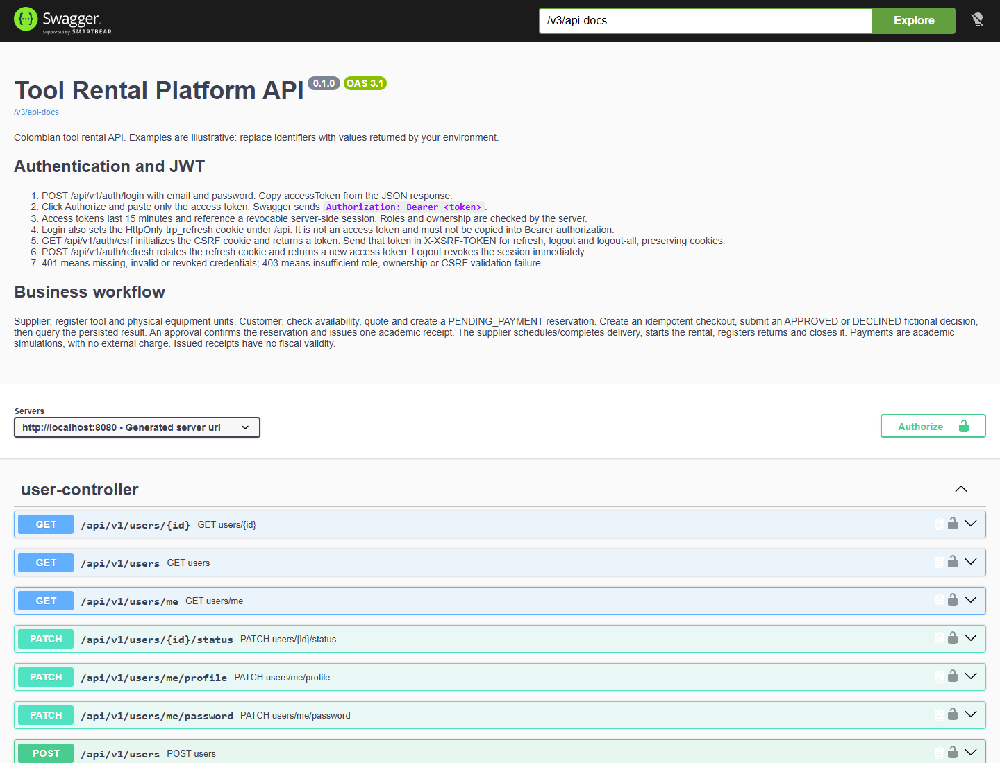

## Funcionamiento verificado con Playwright CLI

Recorridos históricos ejecutados contra **React, Spring Boot/Tomcat y PostgreSQL reales**, en la composición aislada de validación. La configuración vigente usa el proveedor académico persistente y medios de pago fijos; la verificación actual se detalla en [persistencia del proveedor](docs/provider-persistence.md).

| Perfil | Acciones verificadas |
| --- | --- |
| Cliente | Registro, consulta y búsqueda del catálogo, cotización, reserva, aprobación/rechazo del pago, cancelación, descarga de comprobante, renovación y cierre de sesión |
| Proveedor | Publicación y unidades propias, entrega, alquiler, devolución y cierre; cinco reportes con alcance autorizado |
| Administrador | Consulta operativa y gestión del estado de las cuentas; revocación inmediata del acceso al desactivar |
| Contratos REST adicionales | Extensiones, daños y valoración, retracto en revisión, reembolsos registrados, políticas, tarifas y consultas administrativas |

La [matriz de verificación](docs/browser-verification.md) distingue interfaz, REST y pruebas automatizadas; incluye límites y pasos para repetir el recorrido. Los resultados y las huellas de las imágenes están en [la evidencia JSON](docs/evidence/mvp/role-workflows.json).

### Cliente: reserva y pago académico

**Cotización de un día con recogida por el cliente.** El servidor valida disponibilidad y calcula el importe final.

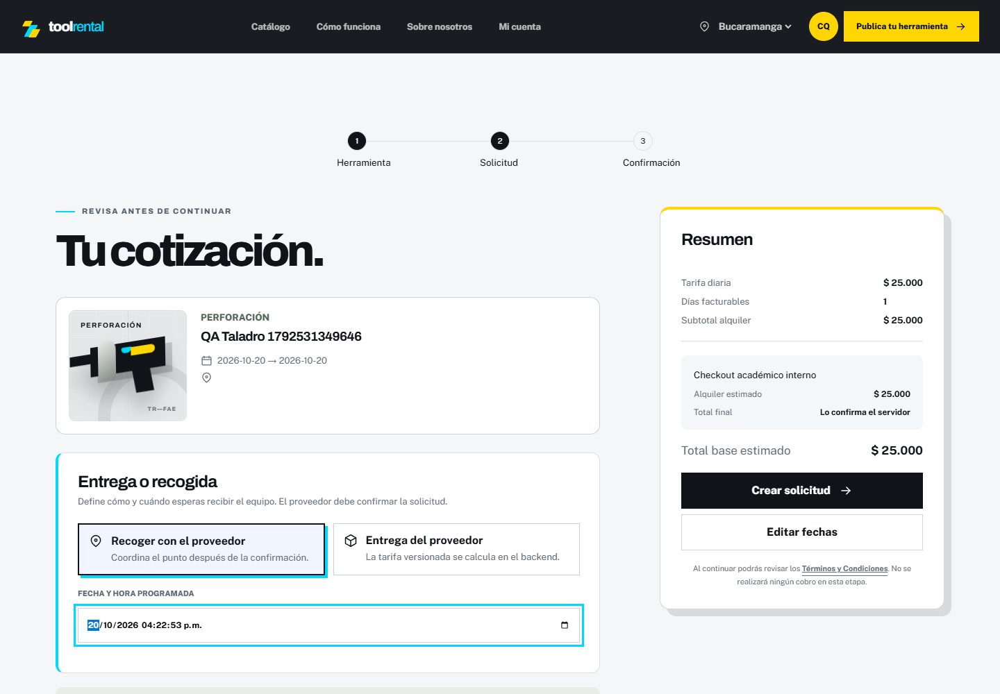

**Pasarela ficticia.** El cliente propietario puede simular aprobación o rechazo; otros usuarios reciben acceso denegado.

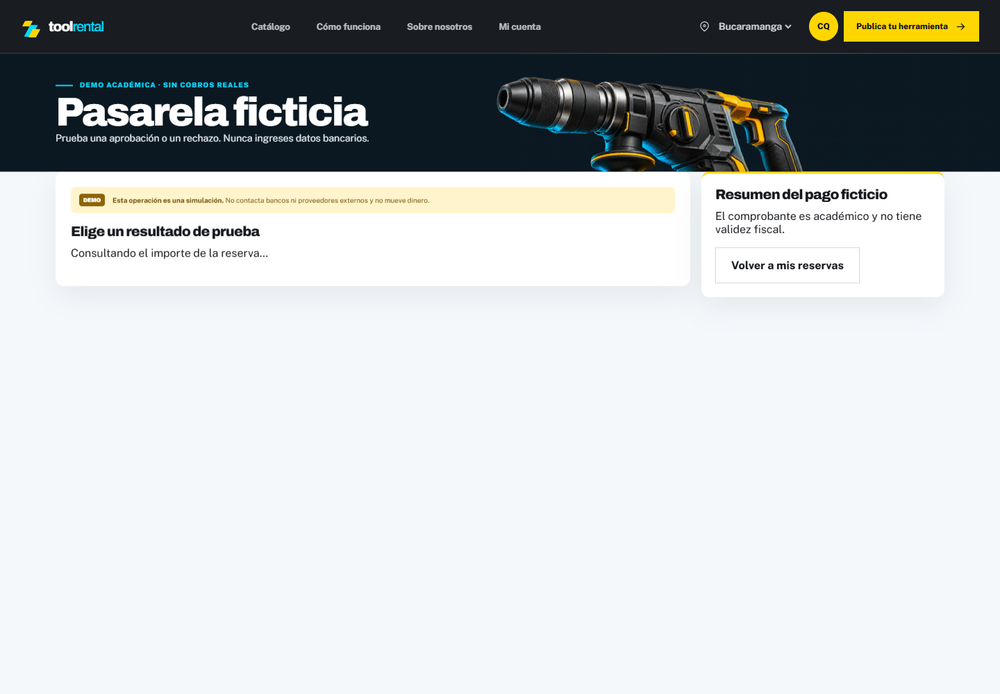

**Aprobación persistida.** Repetir la decisión conserva un solo comprobante; una decisión contradictoria devuelve conflicto.

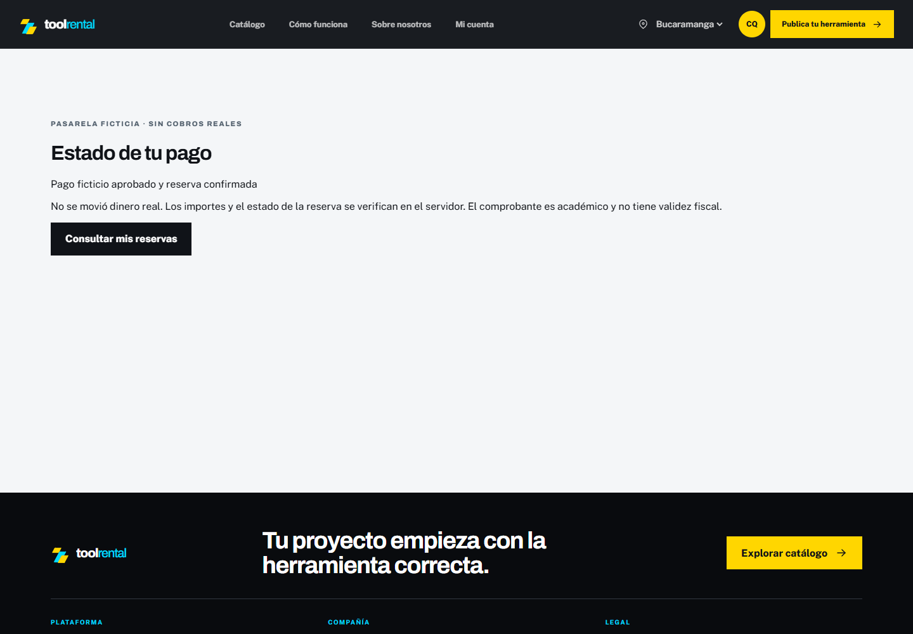

### Proveedor: operación y reportes

**Alquiler completado.** Se programó y completó la entrega, se inició el alquiler y se registró la devolución antes de cerrarlo.

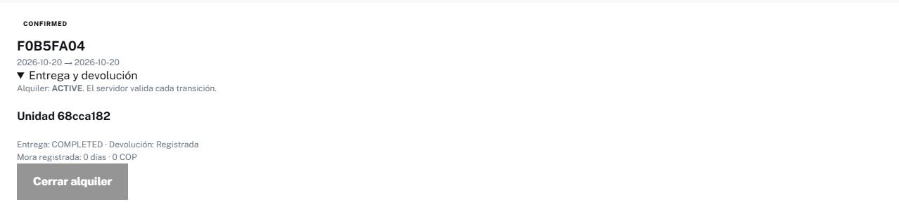

**Reporte consultado en el backend.** El ingreso reservado no se presenta como margen contable.

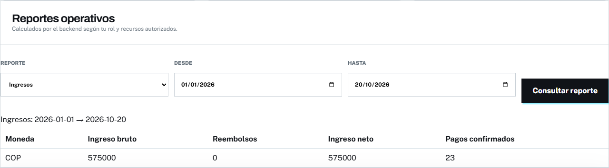

### Administrador: permisos y cuentas

**Gestión administrativa de cuentas.** El administrador puede desactivar una cuenta y revocar inmediatamente sus sesiones.

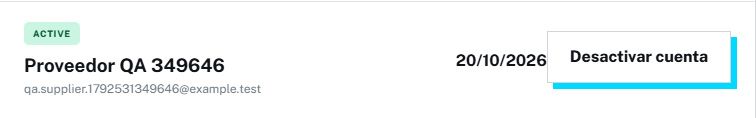

<details>
<summary>Más evidencias: catálogo, inventario, rechazo, comprobante y acceso restringido</summary>

**Búsqueda de una publicación persistida.**

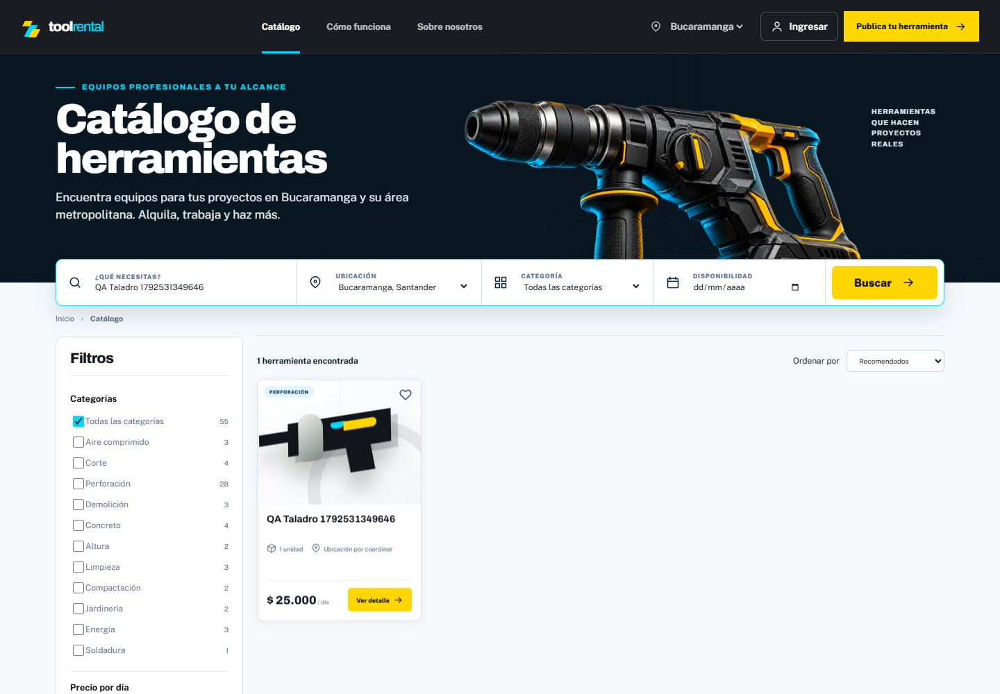

**Herramienta publicada por el proveedor y registro de su unidad física.**

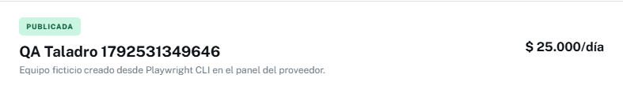

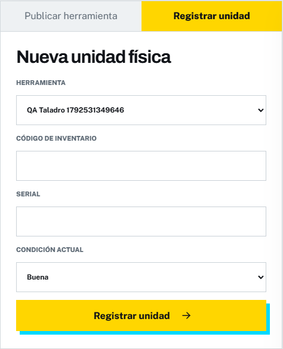

**Rechazo del pago ficticio.** La prueba comprobó después que la unidad podía reservarse nuevamente.


**Comprobante descargado.** Documento académico, sin validez fiscal ante la DIAN.

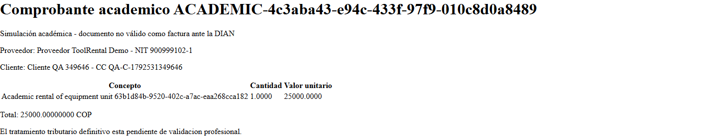

**Cliente sin autorización administrativa.**

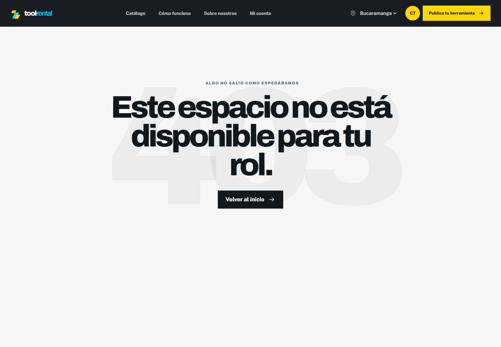

**Catálogo en móvil.**

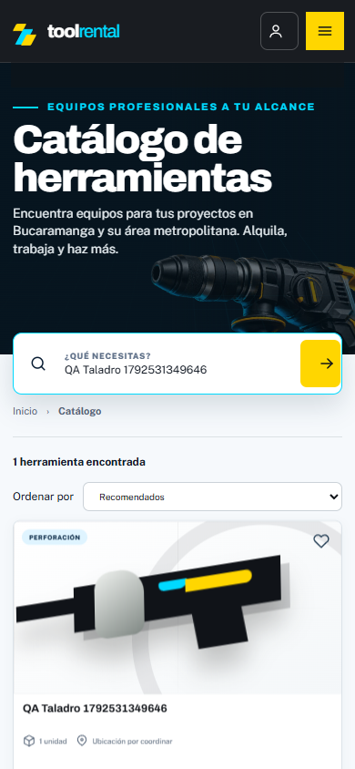

**Catálogo público completo y cuenta nueva sin reservas.**

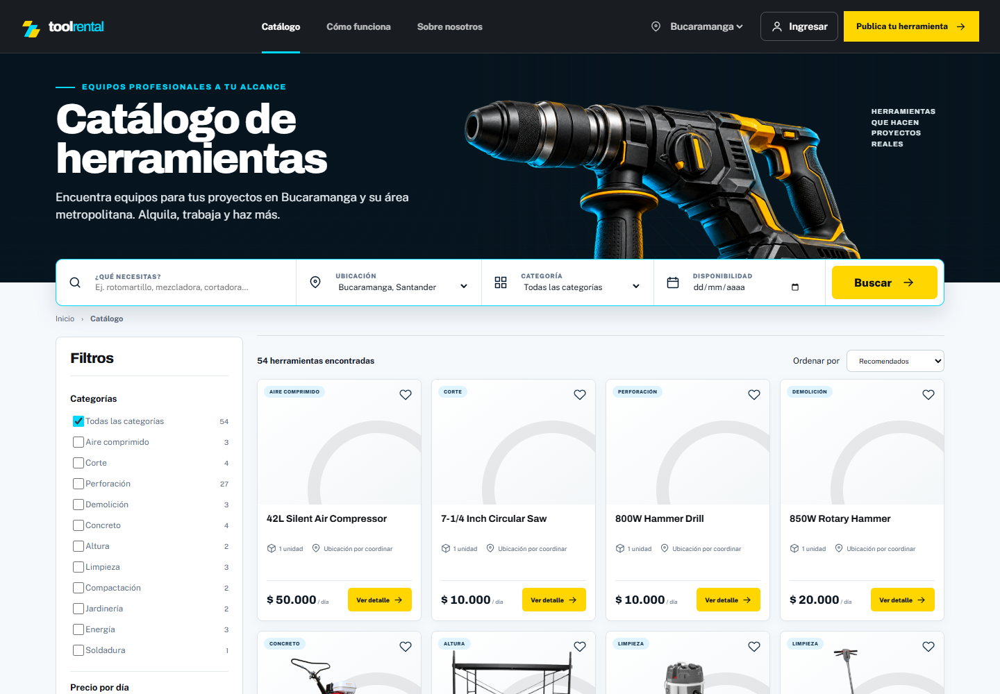

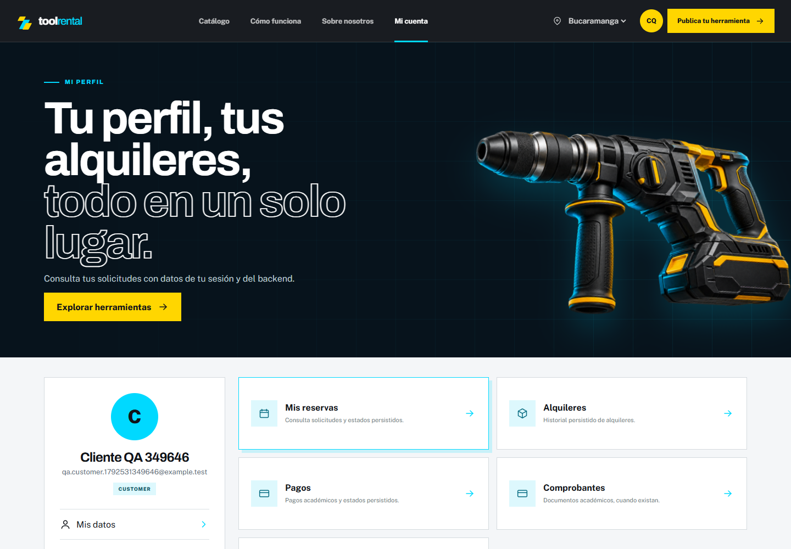

**Reserva y comprobante en la cuenta del cliente.**

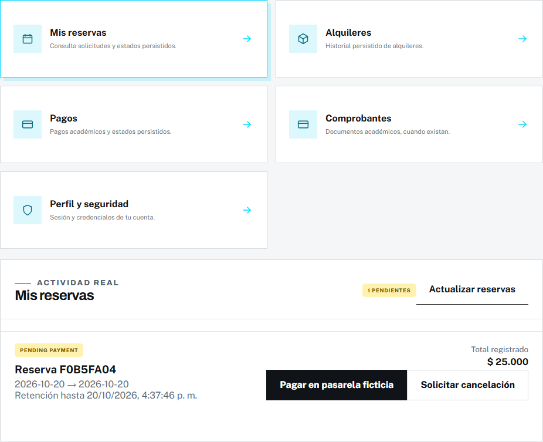

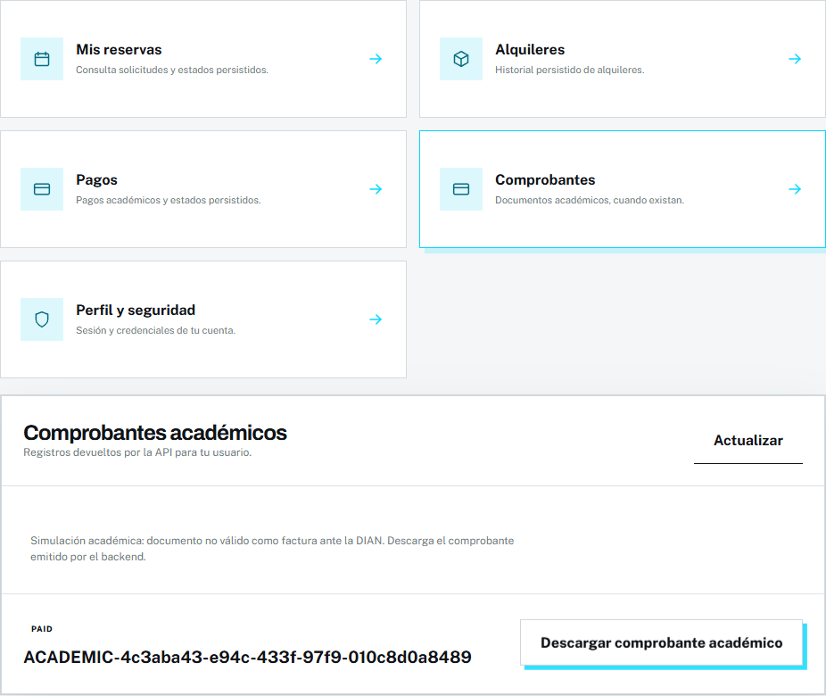

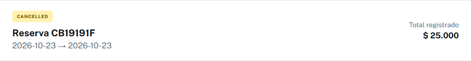

**Publicación del proveedor.**

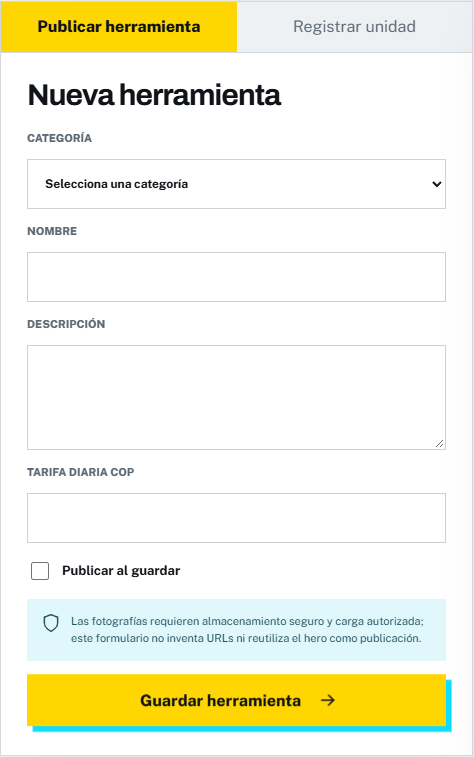

**Administración y rechazo de acceso.**

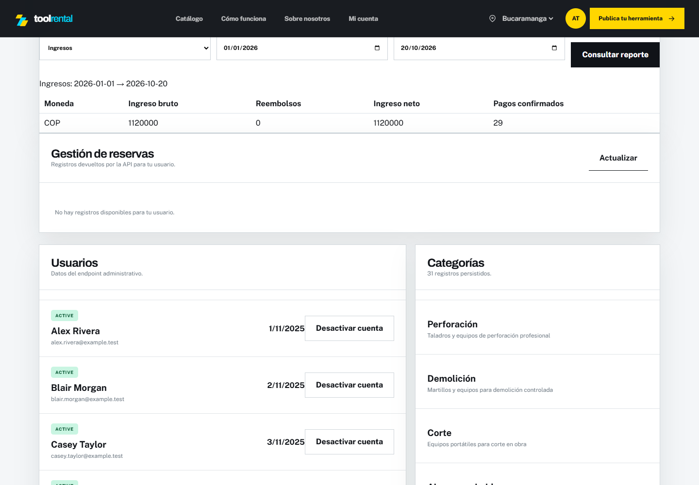

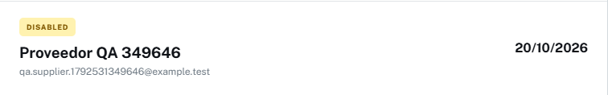

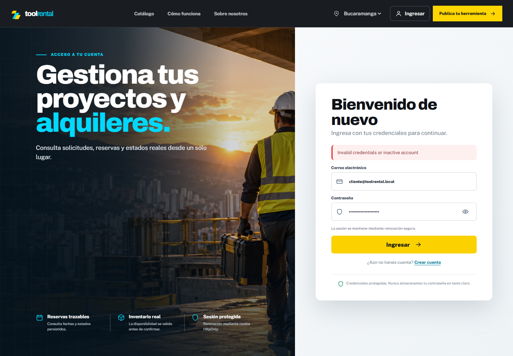

</details>

## Estado actual

El proyecto usa Java 21, Spring Boot 3.5.16, PostgreSQL y Flyway. Los tres módulos Maven conservan las dependencias hacia dentro: `infrastructure → application → domain`. El modelo contiene **26 tablas y 26 contextos organizativos**; las transacciones coordinan las reglas que atraviesan reservas, pagos, sesiones, devoluciones, reembolsos y aceptación legal.

| Área | Implementado | Fuera de este alcance |
| --- | --- | --- |
| Identidad | BCrypt, JWT de acceso, sesiones rotativas, revocación y CSRF; sin recuperación pública de contraseña | MFA y proveedores de identidad externos |
| Reservas | Retención atómica con vencimiento, confirmación automática, cancelación, entrega, devolución, extensión y mora | Optimización logística avanzada |
| Dinero | Visa, Mastercard, PSE, Mercado Pago y PayPal con datos fijos, resultado persistente y comprobante académico | Cobros reales, proveedores financieros externos e impuestos definitivos |
| Reportes | Ingresos, demanda, clientes, disponibilidad, rentabilidad y alquileres vencidos con alcance por rol | Margen contable hasta modelar costos operativos |
| Entrega | Recogida gratuita o entrega del proveedor en Colombia | Tarifas geográficas y transportadoras externas |
| Persistencia | JPA, PostgreSQL, Flyway hasta V309 y datos demo separados | Operación administrada de respaldos y alta disponibilidad |
| API | `/api/v1`, OpenAPI, `ProblemDetail` y alias temporal `/api` | Eliminación futura del alias heredado |

El [enunciado original](ejercicioDemo.md) se conserva sin cambios. PostgreSQL reemplaza a MySQL por decisión autorizada.

## Inicio rápido

Requisitos: JDK 21, PostgreSQL y Docker cuando se quiera ejecutar la suite Testcontainers.

```powershell
$env:JAVA_HOME = 'C:\ruta\al\jdk-21'
.\mvnw.cmd -version
.\mvnw.cmd clean verify
docker compose config --quiet
docker compose up --build
```

Compose levanta PostgreSQL, backend y frontend. Correo, recuperación y restablecimiento de contraseña no forman parte de la aplicación pública. El backend queda en `http://localhost:8080`; la página raíz ejecuta una consulta JDBC real y muestra si la conexión fue exitosa.

### Entorno demostrativo

El Compose local activa los perfiles `local,demo` y carga, sobre una base nueva, un catálogo aislado de 30 herramientas publicadas, 20 herramientas históricas sin publicar y tres cuentas listas para iniciar sesión. No debe activarse sobre una base productiva.

```powershell
Copy-Item .env.example .env
docker compose up --build -d
```

| Rol | Correo | Contraseña | Acceso esperado |
| --- | --- | --- | --- |
| Cliente | `cliente@toolrental.local` | `ToolRental2026!` | Catálogo, cotización, reservas y cuenta |
| Proveedor | `proveedor@toolrental.local` | `ToolRental2026!` | Panel y publicaciones propias |
| Administrador | `admin@toolrental.local` | `ToolRental2026!` | Panel y recursos administrativos |

Estas credenciales existen únicamente en las migraciones `db/demo`; no son usuarios predeterminados de producción. En otro computador, al clonar el repositorio, copiar `.env.example` como `.env` y ejecutar el comando anterior, Flyway crea las tres cuentas automáticamente. La carga está pensada para una base o volumen nuevo; no actives `demo` posteriormente sobre una base que ya haya avanzado hasta V305 sin esas migraciones.

Para ejecutar sin Compose:

```powershell
$env:SPRING_PROFILES_ACTIVE = 'production'
$env:DB_URL = 'jdbc:postgresql://localhost:5432/tool_rental'
$env:DB_USERNAME = 'tool_rental'
$env:DB_PASSWORD = '<secret>'
$env:JWT_SECRET = '<mínimo-32-bytes>'
$env:PAYMENT_PROVIDER = 'fictional'
$env:PAYMENTS_PUBLIC_URL = 'https://app.example'
$env:CORS_ALLOWED_ORIGINS = 'https://app.example'
.\mvnw.cmd -pl infrastructure -am spring-boot:run
```

No actives los perfiles `local,demo` sobre datos reales. Las credenciales se suministran mediante variables o un gestor de secretos.

## Apache Tomcat integrado

El backend se empaqueta como JAR ejecutable. `java -jar infrastructure/target/infrastructure-0.1.0-SNAPSHOT.jar` inicia Spring Boot y su Apache Tomcat integrado en el puerto 8080. El Dockerfile ejecuta ese mismo comando con Java 21; no se instala otro Tomcat ni se usa un WAR. Caddy recibe HTTPS y dirige la API al Tomcat privado. Consulta [el procedimiento de despliegue](docs/deployment.md#apache-tomcat-integrado).

## Arquitectura

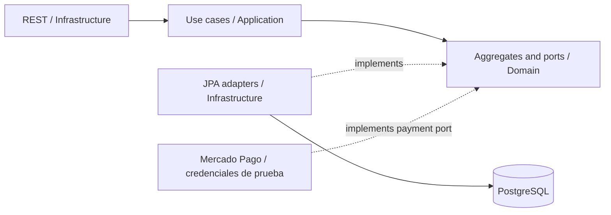

Los módulos Domain y Application no importan Spring, Hibernate ni HTTP. Infrastructure contiene controladores, seguridad, entidades JPA, mappers, repositorios Spring Data y configuración.

<details>
<summary><strong>Ver los 26 contextos y tablas</strong></summary>

| Contexto | Tabla | Contexto | Tabla |
| --- | --- | --- | --- |
| `user` | `users` | `role` | `roles` |
| `userrole` | `user_roles` | `customer` | `customers` |
| `supplier` | `suppliers` | `category` | `categories` |
| `tool` | `tools` | `toolimage` | `tool_images` |
| `equipmentunit` | `equipment_units` | `reservation` | `reservations` |
| `reservationitem` | `reservation_items` | `rental` | `rentals` |
| `unitdelivery` | `unit_deliveries` | `unitreturn` | `unit_returns` |
| `damagereport` | `damage_reports` | `payment` | `payments` |
| `invoice` | `invoices` | `invoiceitem` | `invoice_items` |
| `usersession` | `user_sessions` | `passwordreset` | `password_reset_tokens` |
| `cancellationpolicy` | `cancellation_policies` | `reservationtermination` | `reservation_terminations` |
| `deliveryrate` | `delivery_rates` | `reservationextension` | `reservation_extensions` |
| `refund` | `refunds` | `legalacceptance` | `legal_acceptances` |

</details>

Consulta [arquitectura](docs/backend-architecture.md) y [mapa de paquetes](docs/source-package-map.md).

## Seguridad

- JWT de acceso con `sid` y vigencia predeterminada de 15 minutos. React debe conservarlo únicamente en memoria.
- Refresh token opaco de 256 bits, guardado como hash, con vigencia de 30 días y rotación atómica.
- La reutilización fuera del margen de 10 segundos compromete y revoca toda la familia.
- El refresh vive en cookie `HttpOnly`, ruta `/api`, `SameSite=Lax` y `Secure` en producción.
- Renovación y cierres de sesión exigen cookie CSRF y cabecera `X-XSRF-TOKEN`.
- Cambio de contraseña, cambio de roles y desactivación revocan sesiones activas.
- Recuperación y restablecimiento de contraseña no tienen rutas, páginas ni correo públicos.
- CORS con credenciales acepta únicamente los orígenes configurados.
- Los errores usan `application/problem+json` con `code`, `status`, `detail`, `instance` y `traceId`.

## Reglas críticas de negocio

- Una reserva pendiente se cancela sin cargo.
- Una reserva confirmada cancelada con 48 horas exactas o más recibe reembolso completo; por debajo del límite se cobra 25 %.
- La inasistencia puede declararse dos horas después de la hora programada y cobra 50 %.
- El retracto queda en revisión administrativa. Aprobación: cancelación y reembolso completo. Rechazo: vuelve al estado confirmado.
- Un alquiler ya iniciado bloquea cancelación comercial, inasistencia y retracto.
- Los reembolsos se calculan a partir de pagos confirmados y se registran **pendientes**, con idempotencia; no se marcan como transferidos sin pasarela externa. Si el cargo supera lo pagado se crea un ajuste pendiente.
- `CUSTOMER_PICKUP` cuesta cero. `SUPPLIER_DELIVERY` usa una tarifa COP global, versionada, y una dirección en Colombia.
- Las extensiones conservan la fecha original, actualizan la fecha efectiva, comprueban disponibilidad y usan tarifas congeladas.
- La mora se calcula por día calendario iniciado en la zona `America/Bogota` y se registra como ajuste.

## API REST

El contrato oficial empieza por `/api/v1`. El alias `/api` permanece temporalmente y responde con `Deprecation: true` y un enlace a la ruta sucesora. Swagger solo publica rutas versionadas.

Rutas principales:

- `GET /api/v1/auth/csrf`, `POST /auth/refresh`, `/logout` y `/logout-all`.
- `GET /api/v1/auth/sessions` y `DELETE /auth/sessions/{id}`.
- `GET /api/v1/users/me`, `PATCH /users/me/profile` y `PATCH /users/me/password`: consulta y actualización autenticada del perfil; cambiar la contraseña revoca las sesiones.
- `GET /api/v1/public/features`: disponibilidad del checkout y proveedor de pagos vigente.
- `GET /api/v1/public/catalog?serviceCity={municipio}`: catálogo público filtrado por la ciudad persistida de cada herramienta.
- `POST /api/v1/auth/supplier-registration`: crea la cuenta activa de proveedor, inicia sesión y devuelve la cookie de renovación.
- `POST /api/v1/payments/checkouts`, creación idempotente con el medio fijo elegido; decisión académica persistida en `/payments/fictional/checkouts/{id}/decision`.
- `GET /api/v1/reports/{income|most-rented-tools|frequent-customers|availability|profitability}`.
- `POST /api/v1/reservation-terminations/reservations/{id}/cancellation`, `/no-show`, `/withdrawal`, `/external-review` y `/supplier-failure`.
- `POST /api/v1/reservation-extensions/reservations/{id}` y resolución por aprobación o rechazo.
- `GET|POST /api/v1/commercial-configuration/delivery-rates` y `/cancellation-policies` para administración.
- `GET /api/v1/refunds/payments/{id}` y consulta normal de pagos para ajustes.
- `GET /api/v1/invoices/{id}/document?disposition=inline|attachment`: vista previa o descarga del comprobante académico en PDF.

La especificación está en `http://localhost:8080/v3/api-docs` y Swagger UI en `http://localhost:8080/swagger-ui.html`. Consulta [contratos REST](docs/rest-api.md).

Después de crear y persistir una reserva, el frontend abre automáticamente `/pago?reservationId={id}`. Ese paso muestra el importe del servidor y permite escoger Visa, Mastercard, PSE, Mercado Pago o PayPal. Cada opción presenta datos de prueba fijos y no editables; el backend conserva el medio seleccionado, confirma la reserva y publica el pago y el comprobante en `/cuenta`. Solo se persisten la red de tarjeta, últimos cuatro dígitos y vencimiento, nunca el número completo, CVV o credenciales de una cuenta.

`/cuenta` vuelve a consultar reservas, alquileres, pagos y comprobantes al recuperar el foco o al usar **Actualizar**. Las reservas exponen únicamente acciones permitidas por su estado, incluida la solicitud de extensión; los pagos y comprobantes conservan su historial inmutable. El perfil permite editar nombre y correo, cambiar la contraseña actual y previsualizar o descargar cada comprobante como PDF.

## Migraciones y validación

El historial previo hasta V200 se conserva sin reescritura. Las migraciones aditivas V201–V210 agregan sesiones, recuperación, políticas, terminaciones, tarifa de entrega, extensiones, reembolsos, campos operativos y retenciones/pagos completos. `db/demo/V300–V302` carga políticas, cuentas, catálogo y escenarios históricos académicos. V303 se reserva a showcase y desactiva credenciales conocidas. V304 añade la orquestación del checkout en payments; V305 incorpora decisiones y reembolsos académicos persistidos; V306 añade la ciudad de servicio; V306.1 habilita PSE y Mercado Pago como métodos del checkout fijo; V307 distribuye el catálogo demo por ciudad y V309 registra aceptaciones legales versionadas.

Consulta [pagos académicos](docs/fictional-payments.md): medios fijos, retorno, permisos, persistencia y conciliación. Las integraciones financieras externas y el correo están fuera del alcance.

Hibernate usa `ddl-auto: validate`; Flyway tiene `clean` deshabilitado. Nunca edites una migración aplicada. Revisa [migraciones](docs/database-migrations.md), [compilación](docs/build-and-test.md) y el [reporte de validación](docs/validation-report.md).

## Modelo conceptual

La ilustración conservada es anterior a V210: la factura actualmente pertenece a la reserva y puede preceder al alquiler. Consulta el [modelo relacional vigente y el DDL físico](docs/logical-physical-model.md) para las claves actuales.


[Abrir SVG](docs/diagrams/conceptual-er-model.svg) · [Editar en Excalidraw](docs/diagrams/conceptual-er-model.excalidraw) · [Modelo explicado](docs/conceptual-model.md) · [Normalización 4FN](docs/fourth-normal-form.md)

## Documentación

| Tema | Documento |
| --- | --- |
| Arquitectura y paquetes | [backend-architecture.md](docs/backend-architecture.md) · [source-package-map.md](docs/source-package-map.md) · [Guía de desarrollo](docs/development-guide.md) |
| API y seguridad | [rest-api.md](docs/rest-api.md) · [production-readiness.md](docs/production-readiness.md) |
| Preparación de evaluación backend | [evaluacion-backend.md](docs/evaluacion-backend.md) |
| Modelo y datos | [conceptual-model.md](docs/conceptual-model.md) · [fourth-normal-form.md](docs/fourth-normal-form.md) · [data-sources.md](docs/data-sources.md) |
| Alcance y cobertura | [product-scope.md](docs/product-scope.md) · [requirements-coverage.md](docs/requirements-coverage.md) · [pendientes.md](docs/pendientes.md) |
| Operación | [deployment.md](docs/deployment.md) · [build-and-test.md](docs/build-and-test.md) · [database-migrations.md](docs/database-migrations.md) |
| Rendimiento y accesibilidad del frontend | [Auditoría, mediciones y pruebas](docs/frontend-quality.md) |
| Condiciones | [terms-and-conditions.md](docs/terms-and-conditions.md) |

Los nombres de código y commits se mantienen en inglés. La documentación para el equipo se conserva en español.

---

## Guía completa de ejecución y despliegue

Esta sección permite poner en funcionamiento el proyecto desde un computador nuevo. La forma recomendada es Docker Compose, porque inicia PostgreSQL, el backend y el frontend con versiones compatibles y ejecuta automáticamente las migraciones Flyway.

### 1. Requisitos

Para la ejecución recomendada instala:

- Git.
- Docker Desktop en Windows o macOS, o Docker Engine con el complemento Compose en Linux.
- Al menos 6 GB de memoria disponible para Docker.
- Puertos locales `5173`, `8080` y `5432` libres.

Comprueba la instalación:

```text
git --version
docker --version
docker compose version
```

Para ejecutar los componentes sin Docker también se necesitan:

- JDK 21.
- PostgreSQL 17.
- Node.js 24 y npm.

### 2. Descargar el proyecto

```text
git clone https://github.com/TuMinipeka/Tool-rental-platform.git
cd Tool-rental-platform
git checkout developer/conde
git pull origin developer/conde
```

Si el trabajo ya fue integrado a la rama principal, sustituye `developer/conde` por la rama que se vaya a desplegar.

### 3. Configurar las variables locales

En Windows PowerShell:

```powershell
Copy-Item .env.example .env
```

En Linux o macOS:

```bash
cp .env.example .env
```

Abre `.env` y cambia como mínimo estos valores:

```dotenv
POSTGRES_PASSWORD=una-clave-local-segura
DB_PASSWORD=una-clave-local-segura
JWT_SECRET=un-secreto-aleatorio-de-32-bytes-como-minimo
```

`POSTGRES_PASSWORD` y `DB_PASSWORD` deben ser iguales. El archivo `.env` es privado y no se debe subir a Git. Para la demostración local conserva:

```dotenv
SPRING_PROFILES_ACTIVE=local,demo
PAYMENT_PROVIDER=fictional
VITE_DEMO_MODE=true
```

El perfil `demo` solo debe utilizarse sobre una base nueva y desechable. Nunca debe habilitarse sobre una base productiva.

### 4. Ejecutar todo con Docker Compose

Desde la raíz del repositorio:

```text
docker compose up --build -d
```

La primera ejecución descarga las imágenes, compila el backend y el frontend, crea PostgreSQL y aplica las migraciones. Puede tardar varios minutos.

Consulta el estado:

```text
docker compose ps
docker compose logs -f backend
```

Cuando `postgres`, `backend` y `frontend` estén saludables, abre:

| Servicio | Dirección |
| --- | --- |
| Aplicación web | http://localhost:5173 |
| Backend | http://localhost:8080 |
| Estado de PostgreSQL | http://localhost:8080/status/database |
| Swagger UI | http://localhost:8080/swagger-ui.html |
| OpenAPI JSON | http://localhost:8080/v3/api-docs |

Las cuentas creadas por las migraciones del perfil `demo` son:

| Rol | Correo | Contraseña |
| --- | --- | --- |
| Cliente | `cliente@toolrental.local` | `ToolRental2026!` |
| Proveedor | `proveedor@toolrental.local` | `ToolRental2026!` |
| Administrador | `admin@toolrental.local` | `ToolRental2026!` |

Estas credenciales son exclusivas del entorno académico local.

### 5. Comandos habituales de Docker

Ver todos los registros:

```text
docker compose logs -f
```

Reconstruir después de descargar cambios:

```text
git pull origin developer/conde
docker compose up --build -d
```

Reiniciar los servicios:

```text
docker compose restart
```

Detenerlos sin borrar la base de datos:

```text
docker compose down
```

PostgreSQL persiste en el volumen `postgres_data`. El siguiente comando también elimina la base y solo debe utilizarse cuando se quiera comenzar nuevamente con datos demo:

```text
docker compose down -v
docker compose up --build -d
```

No ejecutes `down -v` si necesitas conservar reservas, usuarios, pagos o facturas.

### 6. Ejecutar la base de datos por separado

Si solo necesitas PostgreSQL en Docker:

```text
docker compose up -d postgres
docker compose ps postgres
```

El backend se conecta con los valores de `.env` mediante `jdbc:postgresql://localhost:5432/tool_rental`.

Si prefieres una instalación local de PostgreSQL, crea el usuario y la base con una cuenta administradora:

```text
psql -U postgres -c "CREATE USER tool_rental WITH PASSWORD 'una-clave-local-segura';"
psql -U postgres -c "CREATE DATABASE tool_rental OWNER tool_rental;"
```

No se deben crear tablas manualmente. Flyway las crea y actualiza cuando arranca el backend. Hibernate utiliza `ddl-auto: validate` y no reemplaza las migraciones.

### 7. Ejecutar el backend sin Docker

Primero inicia PostgreSQL. Después configura la terminal.

Windows PowerShell:

```powershell
$env:SPRING_PROFILES_ACTIVE = 'local,demo'
$env:DB_URL = 'jdbc:postgresql://localhost:5432/tool_rental'
$env:DB_USERNAME = 'tool_rental'
$env:DB_PASSWORD = 'una-clave-local-segura'
$env:JWT_SECRET = 'un-secreto-aleatorio-de-32-bytes-como-minimo'
$env:CORS_ALLOWED_ORIGINS = 'http://localhost:5173'
$env:PAYMENT_PROVIDER = 'fictional'
./mvnw.cmd -pl infrastructure -am spring-boot:run
```

Linux o macOS:

```bash
export SPRING_PROFILES_ACTIVE='local,demo'
export DB_URL='jdbc:postgresql://localhost:5432/tool_rental'
export DB_USERNAME='tool_rental'
export DB_PASSWORD='una-clave-local-segura'
export JWT_SECRET='un-secreto-aleatorio-de-32-bytes-como-minimo'
export CORS_ALLOWED_ORIGINS='http://localhost:5173'
export PAYMENT_PROVIDER='fictional'
chmod +x mvnw
./mvnw -pl infrastructure -am spring-boot:run
```

El backend arranca Spring Boot con Apache Tomcat integrado en `http://localhost:8080`. Al iniciar, Flyway prepara la base automáticamente.

Para generar el JAR sin ejecutar pruebas:

```powershell
./mvnw.cmd -DskipTests -pl infrastructure -am clean package
java -jar infrastructure/target/infrastructure-0.1.0-SNAPSHOT.jar
```

En Linux o macOS usa `./mvnw` en lugar de `./mvnw.cmd`.

### 8. Ejecutar el frontend sin Docker

En otra terminal:

```text
cd frontend
npm ci
npm run dev
```

Abre `http://localhost:5173`. Vite redirige `/api` y `/status` al backend local cuando `VITE_API_BASE_URL` no está definido.

Si el backend usa otra dirección, crea `frontend/.env.local`:

```dotenv
VITE_API_BASE_URL=http://localhost:8080
VITE_DEMO_MODE=true
```

Las variables de Vite se incorporan durante la compilación. Después de cambiarlas hay que detener y volver a iniciar `npm run dev`, o reconstruir la imagen del frontend.

Para compilar una versión estática:

```text
npm run build
npm run preview
```

### 9. Orden correcto de arranque manual

1. Inicia PostgreSQL y confirma que acepta conexiones.
2. Inicia el backend y espera a que `/status/database` indique conexión correcta.
3. Inicia el frontend.
4. Abre `http://localhost:5173` e inicia sesión.

Si se inicia el frontend antes del backend, la interfaz puede mostrar un error de conexión hasta que el servicio Java esté disponible.

### 10. Despliegue público con Docker, dominio y HTTPS

El despliegue público está preparado para un servidor Linux con Docker, un dominio apuntando a su IP y los puertos `80` y `443` abiertos. PostgreSQL, Tomcat y el frontend no deben exponer directamente sus puertos públicos; Caddy es el único punto de entrada.

1. En un computador de construcción limpio, inicia sesión en el registro de contenedores:

   ```bash
   docker login ghcr.io
   docker buildx create --use --name tool-rental-builder
   ```

2. Define el prefijo del registro y construye las imágenes para AMD64 y ARM64:

   ```bash
   export IMAGE_PREFIX='ghcr.io/tu-usuario/tool-rental'
   ./scripts/build-release.sh
   ```

   El script etiqueta las imágenes con el SHA completo del commit y las publica como `backend:<sha>` y `frontend:<sha>`.

3. En el servidor, clona la misma revisión del repositorio:

   ```bash
   git clone https://github.com/TuMinipeka/Tool-rental-platform.git
   cd Tool-rental-platform
   git checkout <sha-publicado>
   cp .env.showcase.example .env.showcase
   ```

4. Configura el registro DNS `A` del dominio para que apunte a la IP pública del servidor. Abre únicamente `80`, `443` y un acceso SSH restringido.

5. Completa `.env.showcase` sin subirlo al repositorio:

   ```dotenv
   PUBLIC_HOST=tu-dominio.example
   ACME_EMAIL=administrador@example.com
   POSTGRES_DB=tool_rental_showcase
   POSTGRES_USER=tool_rental_showcase
   POSTGRES_PASSWORD=una-clave-aleatoria-larga
   JWT_SECRET=un-secreto-aleatorio-de-al-menos-32-bytes
   BACKEND_IMAGE=ghcr.io/tu-usuario/tool-rental/backend:<sha-publicado>
   FRONTEND_IMAGE=ghcr.io/tu-usuario/tool-rental/frontend:<sha-publicado>
   PAYMENT_PROVIDER=fictional
   ```

6. En Linux limita la lectura del archivo:

   ```bash
   chmod 600 .env.showcase
   ```

7. Confirma que las evidencias y compuertas de publicación vigentes estén aprobadas. Después ejecuta:

   ```bash
   ./scripts/release.sh
   ```

   Este script valida la configuración, descarga las imágenes y levanta PostgreSQL, backend, frontend y Caddy. Caddy solicita y renueva el certificado HTTPS automáticamente cuando el dominio y los puertos son correctos.

8. Comprueba desde otro equipo:

   ```text
   https://tu-dominio.example/
   https://tu-dominio.example/status/database
   https://tu-dominio.example/swagger-ui.html
   ```

El entorno `showcase` no publica las credenciales demo conocidas. Los accesos de evaluadores deben provisionarse de forma privada siguiendo [la guía de despliegue](docs/deployment.md). No se deben copiar `.env`, contraseñas, tokens, volúmenes ni respaldos al repositorio.

### 11. Actualizar un despliegue existente

Para desarrollo local:

```text
git pull
docker compose up --build -d
```

Para producción, crea imágenes nuevas identificadas por el nuevo SHA, actualiza `BACKEND_IMAGE` y `FRONTEND_IMAGE` en `.env.showcase`, realiza el respaldo requerido y vuelve a ejecutar `./scripts/release.sh`. No uses la etiqueta `latest` y no reviertas migraciones Flyway aplicadas.

### 12. Solución de problemas frecuentes

- **El navegador no refleja cambios:** ejecuta `docker compose up --build -d` y recarga sin caché. Actualizar la pestaña no reconstruye las imágenes.
- **El backend no conecta con PostgreSQL:** verifica que `POSTGRES_PASSWORD` y `DB_PASSWORD` coincidan y consulta `docker compose logs postgres backend`.
- **Un puerto está ocupado:** cambia `FRONTEND_PORT`, `BACKEND_PORT` o `POSTGRES_PORT` en `.env` y reconstruye.
- **GitHub devuelve `Connection was reset`:** comprueba la conexión, VPN, proxy o firewall y vuelve a ejecutar `git push origin <rama>`.
- **Flyway informa una versión incoherente:** no edites migraciones ya aplicadas. En una base local desechable crea un volumen nuevo; si contiene datos necesarios, prepara una migración hacia delante.
- **El frontend abre pero la API falla:** confirma `http://localhost:8080/status/database`, el valor de `VITE_API_BASE_URL` y `CORS_ALLOWED_ORIGINS`.
- **Docker conserva una versión anterior:** usa `docker compose up --build -d`; si sigue usando caché y no necesitas la imagen anterior, reconstruye explícitamente con `docker compose build --no-cache frontend backend`.

La explicación operativa ampliada, los respaldos y la restauración están en [docs/deployment.md](docs/deployment.md).
