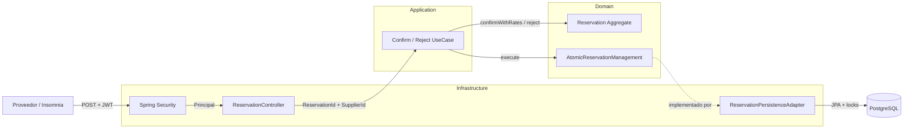
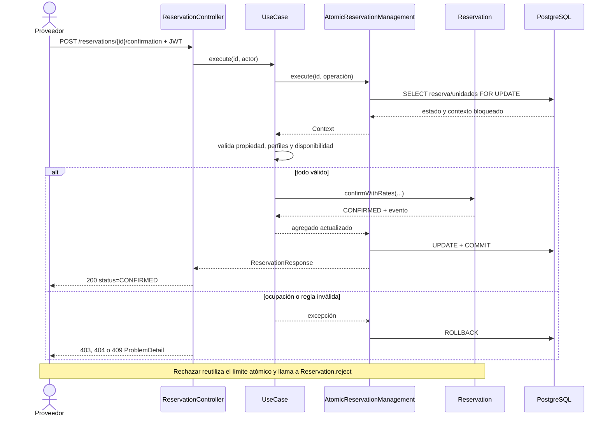
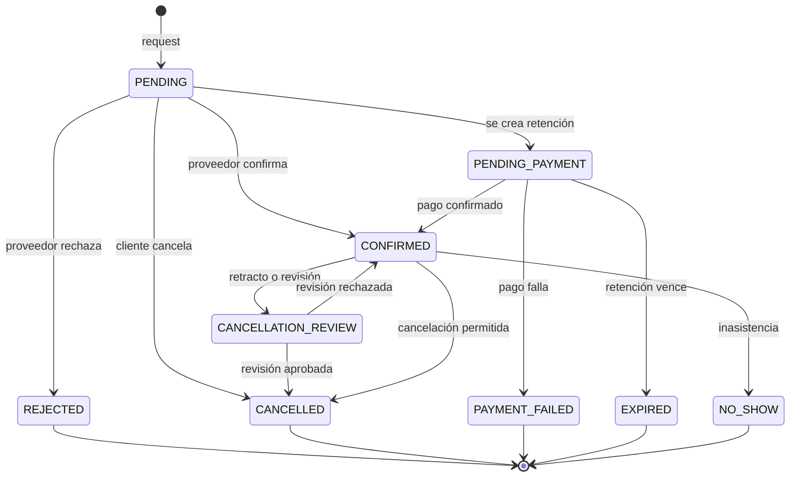
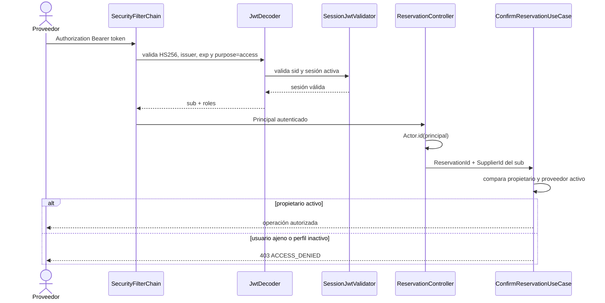
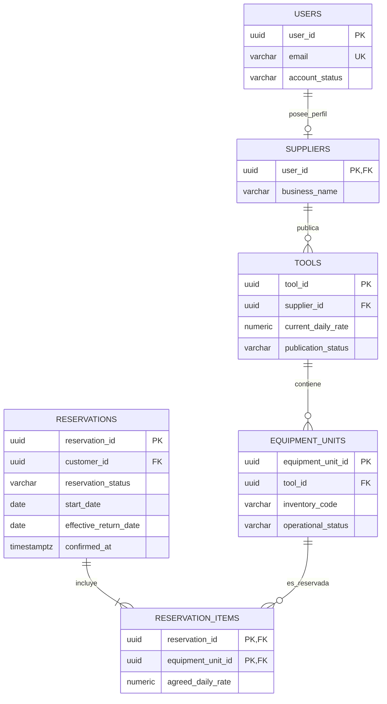

# Diagramas estáticos de respaldo

Estos diagramas resumen el mismo contenido que las vistas Archify. GitHub puede renderizarlos directamente y no requieren conexión externa.

## 1. Arquitectura hexagonal

## 2. Secuencia de confirmación y rechazo

## 3. Estados de la reserva

## 4. JWT y autorización

## 5. Modelo relacional reducido

