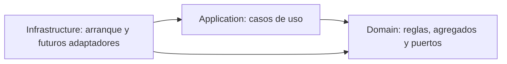
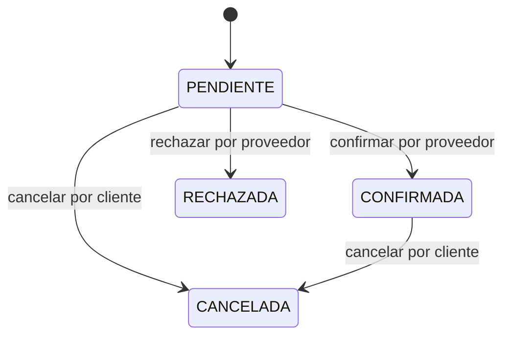

# Arquitectura del backend

## Referencia y alcance

Se adopta la estructura de [SpringBootDataJPA-DDD](https://github.com/TuMinipeka/SpringBootDataJPA-DDD): reactor Maven con `domain`, `application` e `infrastructure`; organización por funcionalidad dentro de cada capa. Se adapta al negocio de renta sin copiar entidades clínicas, configuración de conexión, credenciales ni el criterio de crear un contexto por tabla.

Java 21 y Spring Boot 3.5.16 están fijados en el POM raíz. Los paquetes son `com.toolrental.<modulo>`. El dominio no importa Spring ni JPA; aplicación no conoce infraestructura. ArchUnit comprueba estas fronteras, además de las dependencias Maven.



## Organización y límites de agregado

| Área | Agregado | Responsabilidad |
| --- | --- | --- |
| catalog | Categoria | Identidad y nombre de clasificación. |
| catalog | Herramienta | Oferta de proveedor: categoría, descripción, imágenes, publicación y tarifa diaria. |
| catalog | UnidadEquipo | Identidad física, código de inventario y estado operativo. |
| reservation | Reserva | Cliente, período inclusivo, estado y colección de DetalleReserva. |

`DetalleReserva` es entidad interna de Reserva, identificada por unidad dentro del agregado. No tiene repositorio ni operaciones independientes. Las imágenes son un conjunto de valores URI dentro de Herramienta. Esto no cambia que el modelo relacional almacene imágenes y líneas en relaciones propias.

Proveedor y cliente se representan temporalmente mediante UUID tipados y el puerto `ParticipantesPort`. Este puerto exige perfiles activos con rol coherente. La implementación de identidad, varios roles, `UsuarioRol`, alquileres y cobros queda para futuras entregas. No se crean agregados vacíos para simular esos módulos.

Los agregados no exponen setters genéricos. Las colecciones se copian y se devuelven inmutables. `Dinero` usa `BigDecimal` y `Currency`, rechaza importes negativos y sumas de monedas distintas. No se aplican impuestos, conversión de divisas ni redondeos monetarios implícitos.

Los IDs tipados evitan intercambiar entidades por accidente. Las fechas de reserva son `LocalDate` sin conversión de zona. Las marcas de creación y confirmación son `Instant`, obtenidas con `Clock` inyectado en aplicación. No se restringen reservas a fechas futuras en esta versión.

## Convenciones por capa

```text
domain/<funcionalidad>/
  model/aggregate/
  model/entity/           # Solo donde existen entidades internas
  model/valueobject/
  event/                  # Solo eventos de negocio implementados
  port/repository/
application/<funcionalidad>/
  command/
  dto/
  usecase/
application/common/exception/
infrastructure/
  ToolRentalApplication
```

Al implementar adaptadores se incorporarán `infrastructure/<funcionalidad>/adapters/in/rest`, `adapters/out/persistence/{entity,mapper,repository}` y `config`. No se mantienen directorios con clases vacías. El futuro mapper reconstruirá el dominio sin emitir eventos de creación; no se añaden ahora fábricas de restauración ni detalles JPA innecesarios.

## Casos de uso e interfaces actuales

| Caso de uso | Entrada / resultado | Puertos |
| --- | --- | --- |
| RegistrarCategoria | Nombre → CategoriaResponse | CategoriaRepository |
| RegistrarHerramienta | Proveedor, categoría, descripción, tarifa, imágenes → HerramientaResponse | HerramientaRepository, CategoriaRepository, ParticipantesPort |
| ConsultarCatalogo | Listas y consulta por identidad → DTO inmutable | Repositorios de catálogo |
| RegistrarUnidad | Herramienta y código → UnidadEquipoResponse | RegistroUnidadAtomico |
| SolicitarReserva | Cliente, período y unidades → ReservaResponse | ParticipantesPort, repositorios de herramienta/unidad/reserva, Clock |
| ConfirmarReserva | Reserva y proveedor → ReservaResponse | GestionReservaAtomica, Clock |
| RechazarReserva | Reserva y proveedor → ReservaResponse | GestionReservaAtomica |
| CancelarReserva | Reserva y cliente → ReservaResponse | GestionReservaAtomica |

Los comandos usan identidades tipadas y value objects. Los DTO de respuesta contienen valores inmutables, nunca agregados mutables. `RecursoNoEncontradoException` representa referencias ausentes; `ReglaNegocioException` representa una precondición de negocio inválida. No existe todavía un contrato HTTP ni una traducción a códigos de estado.

El actor recibido no constituye autenticación: en la fase de seguridad, el adaptador de entrada deberá obtenerlo del principal autenticado, no confiar en un ID libre suministrado por HTTP. La comprobación de propietario ya está en los casos de uso, separada de JWT.

## Reglas y transacción de confirmación

1. Una solicitud pendiente contiene al menos una unidad, sin duplicados, de un único proveedor y moneda común. Se verifican las referencias, perfiles, publicación y estado operativo antes de crearla. Su tarifa es estimada.
2. La confirmación verifica nuevamente el propietario, perfiles, publicación, estado operativo y moneda. Utiliza la tarifa vigente del catálogo. Un cambio de moneda requiere una solicitud nueva; no convierte importes.
3. `GestionReservaAtomica.ejecutar(id, operacion)` delimita una transacción mediante un callback Java, independiente de Spring. Su Contexto proporciona lecturas de reserva, unidades, herramientas, perfiles y ocupación.
4. Las comprobaciones de negocio se ejecutan en aplicación y las transiciones en Reserva. El adaptador se encarga de cargar, bloquear, consultar y guardar. Debe bloquear la reserva y las unidades en orden estable, realizar lecturas coherentes de tarifas/estados/perfiles y guardar el resultado al completar el callback. Los cambios concurrentes de catálogo e identidad deberán coordinarse con esa política de bloqueo o control de versión.
5. Ocupación consulta solo reservas CONFIRMADAS, excluyendo la reserva actual. Dos intervalos inclusivos se solapan si ninguno termina antes de que empiece el otro. Las solicitudes pendientes no retienen inventario ni tienen vencimiento automático en esta versión.
6. Reserva devuelve una nueva versión confirmada, con líneas inmutables y un hecho `ReservaConfirmada`. El evento solo está disponible en el agregado: no hay broker, publicación automática ni Outbox. Fallar no guarda una versión parcial ni publica eventos.
7. Rechazo y cancelación usan el mismo puerto atómico para serializarse con la confirmación. El contexto entrega una copia aislada de Reserva; si el callback falla después de modificarla, el almacenamiento original permanece intacto.

La comprobación de disponibilidad y el guardado **no** se implementan como llamadas independientes al repositorio. Así el contrato permite prevenir la doble reserva al agregar PostgreSQL. La entrega actual solo incluye un adaptador sincronizado en pruebas; no demuestra concurrencia ni bloqueos en una base real.

`RegistroUnidadAtomico` exige validar la herramienta, comprobar código único dentro de su proveedor y registrar la unidad indivisiblemente. La unicidad de nombre de categoría se comprueba en aplicación y deberá reforzarse con una restricción física al incorporar PostgreSQL. No se ofrecen aún casos de uso para modificar la tarifa, retirar equipos o transferir propiedad: existen comportamientos de dominio, pero su coordinación transaccional deberá completarse antes de exponerlos.

## Estados y facturación



RECHAZADA y CANCELADA son terminales. Confirmar nuevamente o rechazar una confirmada falla. No hay modificación de período o unidades después de solicitar; si se necesitan otros datos, se cancela y se solicita otra reserva. Una confirmada conserva fechas, líneas y tarifas.

Se cobra `diasEntre(inicio, devolucion) + 1`; ambas fechas participan en disponibilidad. Del 14 al 15 cuesta dos días y bloquea ambas fechas. Del 15 al 16 entra en conflicto; la siguiente reserva de esa unidad puede empezar el 16. El pago será requisito de entrega en la fase de alquileres/cobros; no condiciona la confirmación actual.

## Verificación y próximas fases

`mvnw clean verify` ejecuta pruebas JUnit de dominio y aplicación, arquitectura y contexto Spring sin DataSource, y verifica el formato Java. El adaptador de prueba vive exclusivamente en `application/src/test` y no se incluye en el JAR de producción.

Verificación realizada el 14 de octubre de 2026 con JDK 21.0.12.1: `mvnw.cmd clean verify` terminó en BUILD SUCCESS, con 22 pruebas, cero fallos, cero errores y cero omisiones. Se ejecutó además el JAR empaquetado: registró `Started ToolRentalApplication` y terminó con código 0, sin requerir base de datos.

La siguiente fase implementará PostgreSQL/Flyway y adaptadores JPA separados del dominio, con `ddl-auto: validate`, restricciones físicas, reconstrucción de agregados y pruebas de integración/concurrencia. Después se implementará seguridad JWT, roles múltiples y autorización por propietario. El frontend queda pendiente de selección tecnológica.
