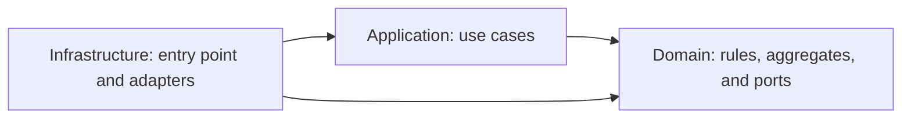
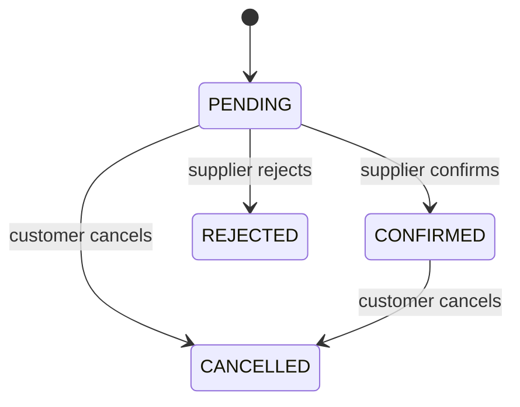

# Backend architecture

## Scope and dependency direction

The project follows the three-module structure of [SpringBootDataJPA-DDD](https://github.com/TuMinipeka/SpringBootDataJPA-DDD), adapted to the tool-rental business. It does not copy clinical entities, credentials, or the idea that every table is a bounded context.

Java 21 and Spring Boot 3.5.16 are fixed in the root POM. Packages start with `com.toolrental.<module>`. Domain does not import Spring or JPA, and application does not know infrastructure. ArchUnit and Maven dependencies enforce these boundaries.



## Aggregate boundaries

| Context | Aggregate | Responsibility |
| --- | --- | --- |
| catalog | `Category` | Classification identity and name. |
| catalog | `Tool` | Supplier offer: category, description, images, publication, and daily rate. |
| catalog | `EquipmentUnit` | Physical identity, inventory code, and operational status. |
| reservation | `Reservation` | Customer, inclusive period, status, and `ReservationItem` collection. |

`ReservationItem` is internal to `Reservation` and has no independent repository. Images are URI values inside `Tool`. A future relational model may store both in separate tables without changing the aggregate boundaries.

Customer and supplier are currently typed IDs checked through a PostgreSQL `ParticipantsPort` adapter. Identity writes, rentals, payments, and invoicing remain future contexts. Empty aggregates are not created as placeholders.

Aggregates expose behavior instead of generic setters. Collections are immutable snapshots. `Money` combines `BigDecimal` and `Currency`, rejects negative amounts, and rejects addition across currencies. Typed IDs prevent accidental identity interchange.

Reservation dates are `LocalDate`. Creation and confirmation timestamps are `Instant` obtained from an injected `Clock`.

## Package conventions

```text
domain/<context>/
  model/aggregate/
  model/entity/
  model/valueobject/
  event/
  port/repository/

application/<context>/
  command/
  dto/
  exception/
  usecase/

infrastructure/<context>/
  adapters/in/rest/{controllers,dtos}/
  adapters/out/persistence/{entity,mapper,repository}/
  config/
```

These conventions are mandatory for future changes. See the [development guide](development-guide.md) for the implementation workflow and review checklist.

## Current use cases

| Use case | Input / result | Ports |
| --- | --- | --- |
| `RegisterCategoryUseCase` | name → `CategoryResponse` | `CategoryRepository` |
| `RegisterToolUseCase` | supplier, category, description, rate, images → `ToolResponse` | `ToolRepository`, `CategoryRepository`, `ParticipantsPort` |
| `QueryCatalogUseCase` | lists and identity lookup → immutable responses | catalog repositories |
| `RegisterEquipmentUnitUseCase` | tool and inventory code → `EquipmentUnitResponse` | `AtomicEquipmentUnitRegistration` |
| `RequestReservationUseCase` | customer, period, units → `ReservationResponse` | participants and catalog/reservation repositories |
| `ConfirmReservationUseCase` | reservation and supplier → `ReservationResponse` | `AtomicReservationManagement`, `Clock` |
| `RejectReservationUseCase` | reservation and supplier → `ReservationResponse` | `AtomicReservationManagement` |
| `CancelReservationUseCase` | reservation and customer → `ReservationResponse` | `AtomicReservationManagement` |

Commands use typed IDs and value objects. Responses are immutable and never expose a mutable aggregate. Missing-reference exceptions belong to application; invalid business preconditions use `BusinessRuleException`.

An actor parameter is not authentication. A future REST adapter must obtain it from the authenticated principal instead of trusting a request-body ID. Ownership checks already live in use cases and remain separate from JWT parsing.

## Atomic reservation management

1. A pending request contains at least one distinct unit, one supplier, and one currency. References, active profiles, publication, and operational status are checked before creation. Its rate is an estimate.
2. Confirmation rechecks supplier ownership, profiles, publication, operational status, currency, and availability. It uses the current catalog rate. A currency change requires a new request.
3. `AtomicReservationManagement.execute(id, operation)` defines a framework-independent transaction callback. Its `Context` supplies the reservation, units, tools, profiles, and occupancy query.
4. The adapter must load and lock the reservation and units in stable order, provide coherent reads, and save only after the callback succeeds. Concurrent catalog and identity changes require compatible locking or versioning.
5. Occupancy considers only other `CONFIRMED` reservations. Inclusive intervals overlap unless one ends before the other begins. Pending requests do not hold inventory.
6. Confirmation returns a new aggregate version with immutable items and one `ReservationConfirmed` event. Failure saves no partial version and publishes no event.
7. Rejection and cancellation use the same atomic port to serialize with confirmation.

Availability checking and saving must not become independent repository calls. The boundary exists specifically to prevent double booking when PostgreSQL is added.

`AtomicEquipmentUnitRegistration` similarly requires validation of the tool, supplier-scoped inventory-code uniqueness, and insertion as one operation. Category-name uniqueness must also receive a physical constraint when persistence exists.

## Reservation state machine



`REJECTED` and `CANCELLED` are terminal. A reservation cannot change its period or units after it is requested; cancel and create another request instead.

Both reservation dates are billable and participate in availability. October 14–15 costs two days. A reservation ending October 15 conflicts with another starting October 15; the next non-overlapping reservation may start October 16.

## Persistence implementation

- PostgreSQL uses versioned Flyway migrations with plural `snake_case` table names and singular columns.
- JPA entities, Spring Data repositories, mappers, and domain-port adapters remain in infrastructure.
- Mappers rebuild aggregates through `restore` without emitting new events.
- Hibernate uses `ddl-auto: validate`; Flyway exclusively owns schema changes.
- Primary keys, alternate keys, foreign keys, checks, and indexes reinforce local invariants.
- Atomic adapters use pessimistic locks in stable order for equipment-unit registration and reservation transitions.
- Integration and concurrent confirmation tests against real PostgreSQL remain pending.

The normalized database has more relations than the domain has aggregates. That is intentional: normalization protects stored facts, while DDD protects transactional business invariants.

## Current operational boundary

Production JPA adapters now implement catalog, participant-read, reservation, and atomic-operation ports. Flyway defines all 18 normalized relations, although only current catalog/reservation capabilities have adapters. A configured PostgreSQL instance is required for normal startup. No REST endpoint, identity-write adapter, JWT filter, external event publisher, rental/payment/invoice adapter, or payment processor exists yet.

Compilation verifies the Java integration without a database. Full completion still requires Testcontainers tests that apply Flyway and exercise mappings and locks against PostgreSQL; these are tracked in [Pending database work](pendientes-base-datos.md).
