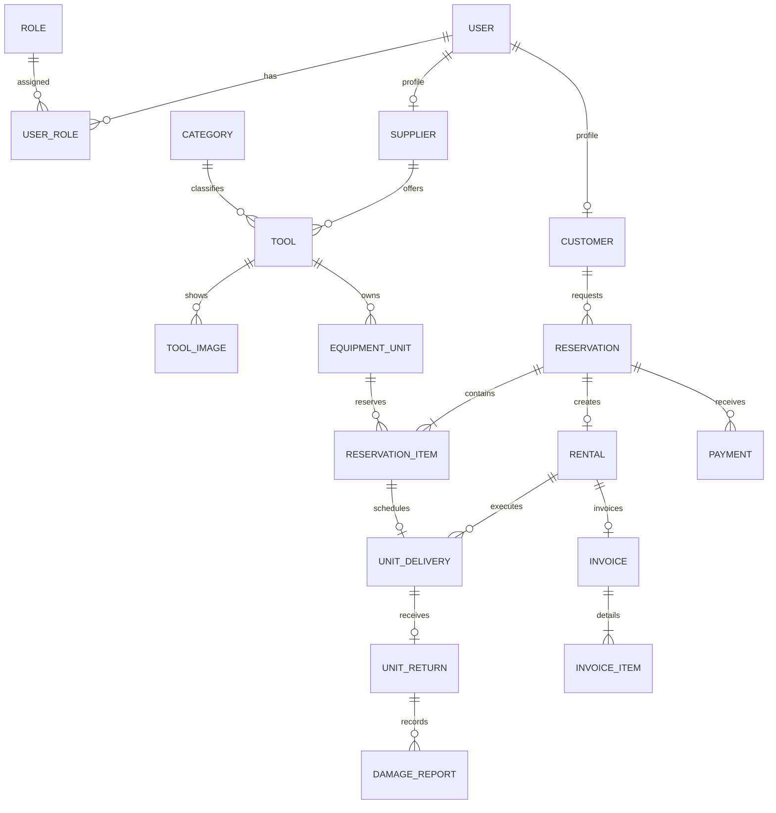

# Tool rental conceptual model

## Scope

Source: [original assignment (Spanish)](../ejercicioDemo.md). This document identifies business concepts, attributes, relationships, and rules. The logical relational model appears in [Fourth normal form](fourth-normal-form.md), and implemented aggregate boundaries appear in [Backend architecture](backend-architecture.md).

Catalog and reservation behavior currently exists in Java. SQL, JPA, JWT, rentals, payments, invoicing, reporting, frontend, and deployment remain pending. PostgreSQL intentionally replaces the MySQL choice in the original brief.

## Derived concepts

| Requirement | Concepts |
| --- | --- |
| Supplier/customer registration and Admin/Supplier/Customer profiles | User, Role, Customer, Supplier |
| Inventory, category, description, images, prices, condition | Tool, Category, ToolImage, EquipmentUnit |
| Date selection and request acceptance/rejection | Reservation, ReservationItem |
| Rental history, delivery, and return | Rental, UnitDelivery, UnitReturn |
| Damage reporting | DamageReport |
| Online payments and invoices | Payment, Invoice, InvoiceItem |

`UserRole` and `ReservationItem` are associative entities. Administrator is a role, not a second copy of User data.

## Business assumptions

1. One account may hold multiple roles. Customer and Supplier are optional, compatible User profiles. Removing a role must not invalidate historical operations.
2. A Tool is one supplier's catalog offer in one primary Category. Each physical EquipmentUnit has an inventory code unique within its supplier.
3. Tool images describe the offer, not a physical unit. Tool images and equipment units are independent sets. Damage or unit-specific images would require separate relationships.
4. A Reservation contains one or more physical units from one supplier. A multi-supplier selection creates separate reservations.
5. Reservation lines share one inclusive `[startDate, returnDate]` period and one currency. Both dates are billed. The rate is frozen on confirmation.
6. A confirmed Reservation creates at most one Rental. Reservation is the request; Rental is its execution.
7. Each rented unit has at most one delivery and one return in a Rental. A return may have several damage reports.
8. A Reservation may have multiple payment attempts or partial payments. Card details are never stored.
9. A Rental has at most one Invoice. Issuer, recipient, and invoice-item values are immutable historical snapshots.
10. Internal identifiers are stable. Names, addresses, statuses, and prices are not entity identities.

Changing these assumptions may change functional or multivalued dependencies and therefore requires a new normalization review.

## Entities and attributes

`?` marks an optional attribute. Names are conceptual camelCase names; physical PostgreSQL names use `snake_case`.

| Entity | Identity | Main attributes |
| --- | --- | --- |
| User | userId; unique email | displayName, email, passwordHash, accountStatus, registeredAt |
| Role | roleId; unique code | code (`ADMIN`, `SUPPLIER`, `CUSTOMER`), description |
| UserRole | user + role | Role assignment without additional attributes |
| Customer | user | personType, documentType, documentNumber, billingName |
| Supplier | user | documentType, documentNumber, businessName |
| Category | categoryId; unique name | name, description? |
| Tool | toolId | supplier, category, name, description, currentDailyRate, rateCurrency, publicationStatus |
| ToolImage | tool + URL | imageUrl |
| EquipmentUnit | equipmentUnitId; supplier + inventoryCode | tool, inventoryCode, serialNumber?, currentCondition, operationalStatus |
| Reservation | reservationId | customer, createdAt, startDate, returnDate, expiresAt?, reservationStatus, currency |
| ReservationItem | reservation + equipmentUnit | agreedDailyRate |
| Rental | reservation | startedAt, rentalStatus |
| UnitDelivery | reservation + equipmentUnit | scheduledAt, deliveredAt?, outboundCondition?, addressLine, city, region, country |
| UnitReturn | reservation + equipmentUnit | receivedAt, inboundCondition, notes? |
| DamageReport | damageReportId | affected return, reportedAt, description, reportStatus, assessedCost? |
| Payment | paymentId; processor + externalReference | reservation, processor, externalReference, amount, paymentStatus, recordedAt, confirmedAt? |
| Invoice | invoiceId; unique reservation; unique number | rental, number, issuedAt, invoiceStatus, issued issuer/recipient names and documents |
| InvoiceItem | invoice + lineNumber | issuedDescription, quantity, issuedUnitPrice |

Money values use exact decimals and explicit currencies. No implicit currency conversion is performed.

## Relationships

| Relationship | Cardinality |
| --- | --- |
| User — Role | N:M through UserRole |
| User — Customer / Supplier | User has 0..1 of each profile; each profile belongs to one User |
| Supplier — Tool | Supplier 0..N; Tool exactly 1 Supplier |
| Category — Tool | Category 0..N; Tool exactly 1 Category |
| Tool — ToolImage / EquipmentUnit | Tool 0..N of each; each child belongs to one Tool |
| Customer — Reservation | Customer 0..N; Reservation exactly 1 Customer |
| Reservation — EquipmentUnit | N:M through ReservationItem |
| Reservation — Rental | Reservation 0..1; Rental exactly 1 Reservation |
| ReservationItem — UnitDelivery | Item 0..1; delivery exactly 1 item and 1 rental |
| UnitDelivery — UnitReturn | Delivery 0..1; return exactly 1 completed delivery |
| UnitReturn — DamageReport | Return 0..N; report exactly 1 return |
| Reservation — Payment | Reservation 0..N; payment exactly 1 reservation |
| Rental — Invoice | Rental 0..1; invoice exactly 1 rental |
| Invoice — InvoiceItem | Issued invoice 1..N; item exactly 1 invoice |

## Editable conceptual diagram

The 18-entity baseline is available as an [editable Excalidraw scene](diagrams/conceptual-er-model.excalidraw), a [vector preview](diagrams/conceptual-er-model.svg), and a [PNG image](diagrams/conceptual-er-model.png). See the [notation and editing guide](diagrams/README.md).

## Conceptual diagram

## Rules and derived information

- `startDate <= returnDate`; monetary amounts are non-negative and payments are positive.
- A unit cannot belong to two overlapping confirmed reservations. Inclusive boundaries mean a shared return/start date conflicts.
- Availability is derived from blocking reservations, expiration policy, operational status, and rentals not yet returned. It is not a global boolean.
- Every reservation item belongs to the same supplier. Tool ownership cannot change while obligations exist without an explicit historical ownership model.
- Items, dates, currency, and rates freeze at confirmation.
- Rental details derive from the confirmed reservation; they are not duplicated.
- Historical actors, equipment, invoices, and payments are deactivated or retained rather than deleted.
- Collected revenue comes from confirmed payments. Invoiced and collected totals are distinct metrics.
- Derived totals should not be stored in the initial normalized model.
- Supplier confirmation blocks units without prior payment. Payment becomes a delivery condition in a later phase.

## DDD mapping

The conceptual model does not imply one aggregate or JPA entity per row. The current implementation uses `Category`, `Tool`, `EquipmentUnit`, and `Reservation` as aggregate roots. `ReservationItem` belongs to `Reservation`, while tool images are values owned by `Tool`. Identity, rentals, payments, invoicing, and reporting remain pending.
