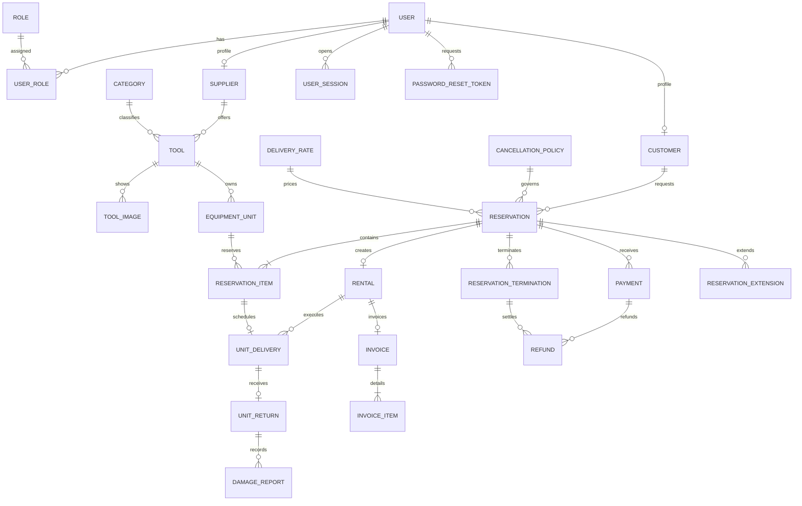

# Modelo conceptual de alquiler de herramientas

## Alcance y supuestos

Fuente: [enunciado original](../ejercicioDemo.md). Se identifican entidades, atributos, relaciones y multiplicidades. El [modelo lógico 4FN](fourth-normal-form.md) y la [arquitectura](backend-architecture.md) explican su traducción a tablas y código. PostgreSQL sustituye MySQL por decisión autorizada.

1. Un usuario puede tener varios roles. Cliente y proveedor son perfiles opcionales compatibles; administrador es un rol, no otra copia de usuario.
2. Una herramienta representa la oferta de un proveedor y tiene una categoría principal. Una unidad representa el equipo físico con código de inventario único dentro de su proveedor.
3. Las imágenes describen la herramienta; no dependen de una unidad física. Ambos conjuntos son independientes.
4. Una reserva incluye una o más unidades distintas de un solo proveedor. Selecciones de varios proveedores requieren reservas separadas.
5. Todas las líneas comparten fechas inclusivas y moneda. Del 14 al 15 se cobran dos días. La confirmación congela fechas, líneas y tarifas.
6. Una reserva confirmada genera como máximo un alquiler: la reserva es la solicitud; el alquiler representa su ejecución.
7. Cada unidad alquilada tiene como máximo una entrega y una devolución en ese alquiler. Una devolución puede tener varios reportes de daño.
8. Una reserva puede registrar pagos parciales, ajustes y reembolsos. No se almacena el número completo ni el CVV.
9. Una reserva tiene como máximo una factura, emitida al aprobar el pago académico; puede existir antes del alquiler. Sus datos son instantáneas históricas.
10. La reserva congela modalidad, hora, dirección opcional, política y tarifa de entrega aplicadas.
11. Sesiones y recuperación conservan exclusivamente hashes de secretos opacos.
12. Nombres, direcciones y tarifas no constituyen identidades estables.

Modificar estos supuestos exige revisar dependencias funcionales y multivaluadas. El modelo base no incluye protección, evidencias ni consentimientos futuros.

## Entidades y atributos

`?` indica atributo opcional. Se conservan nombres conceptuales en inglés para corresponder con el código; PostgreSQL utiliza `snake_case`.

| Entidad | Identidad | Atributos principales |
| --- | --- | --- |
| User | userId; único email | displayName, email, passwordHash, accountStatus, registeredAt |
| Role | roleId; único code | code (`ADMIN`, `SUPPLIER`, `CUSTOMER`), description |
| UserRole | user + role | Asignación de rol sin atributos adicionales |
| Customer | user | personType, documentType, documentNumber, billingName |
| Supplier | user | documentType, documentNumber, businessName |
| Category | categoryId; único name | name, description? |
| Tool | toolId | supplier, category, name, description, currentDailyRate, rateCurrency, publicationStatus |
| ToolImage | tool + URL | imageUrl |
| EquipmentUnit | equipmentUnitId; supplier + inventoryCode | tool, inventoryCode, serialNumber?, currentCondition, operationalStatus |
| Reservation | reservationId | customer, createdAt, startDate, returnDate, effectiveReturnDate, scheduledFulfillmentAt, fulfillmentMethod, dirección?, política, tarifa de entrega?, deliveryFee, status, currency |
| ReservationItem | reservation + equipmentUnit | agreedDailyRate |
| Rental | reservation | startedAt, rentalStatus |
| UnitDelivery | reservation + equipmentUnit | scheduledAt, deliveredAt?, method, status, condición?, dirección, failureType?, failureReason?, failedAt? |
| UnitReturn | reservation + equipmentUnit | receivedAt, inboundCondition, notes?, lateDays, lateFee, currency |
| DamageReport | damageReportId | devolución afectada, reportedAt, description, reportStatus, assessedCost? |
| Payment | paymentId; processor + externalReference | reservation, amount, status, stage, idempotencyKey, adjustmentType?, adjustmentReference?, datos mínimos del medio simulado |
| Invoice | invoiceId; único reservation; único number | reservation, number, issuedAt, invoiceStatus, nombres y documentos históricos de emisor/destinatario |
| InvoiceItem | invoice + lineNumber | issuedDescription, quantity, issuedUnitPrice |
| UserSession | sessionId; único refreshTokenHash | familyId, user, status, createdAt, expiresAt, rotatedAt?, revokedAt?, replacedBy?, clientLabel? |
| PasswordResetToken | passwordResetTokenId; único tokenHash | user, createdAt, expiresAt, usedAt?, revokedAt? |
| CancellationPolicy | cancellationPolicyId; único version | cutoffHours, lateCancellationRate, noShowRate, noShowGraceMinutes, active, effectiveAt |
| ReservationTermination | reservationTerminationId; único idempotencyKey | reservation, type, status, actors, times, reason?, fee, refund, outstanding, currency |
| DeliveryRate | deliveryRateId; único version | amount COP, active, effectiveAt |
| ReservationExtension | reservationExtensionId; único idempotencyKey | reservation, requestedBy, requestedReturnDate, status, times, additionalAmount, currency |
| Refund | refundId; único idempotencyKey | payment, termination?, amount, currency, status, recordedAt, confirmedAt? |

Los importes usan decimales exactos y moneda explícita. No hay conversión implícita de moneda.

## Relaciones y multiplicidades

| Relación | Multiplicidad |
| --- | --- |
| User — Role | N:M mediante UserRole; cada asociación tiene un usuario y un rol |
| User — Customer / Supplier | Usuario 0..1 de cada perfil; cada perfil tiene exactamente un usuario |
| Supplier — Tool | Proveedor 0..N herramientas; herramienta exactamente un proveedor |
| Category — Tool | Categoría 0..N herramientas; herramienta exactamente una categoría |
| Tool — ToolImage / EquipmentUnit | Herramienta 0..N de cada conjunto; cada elemento pertenece a una herramienta |
| Customer — Reservation | Cliente 0..N reservas; reserva exactamente un cliente |
| Reservation — EquipmentUnit | N:M mediante ReservationItem; reserva 1..N líneas |
| Reservation — Rental | Reserva 0..1 alquiler; alquiler exactamente una reserva |
| ReservationItem — UnitDelivery | Línea 0..1 entrega; entrega exactamente una línea y un alquiler |
| UnitDelivery — UnitReturn | Entrega 0..1 devolución; devolución exige una entrega completada |
| UnitReturn — DamageReport | Devolución 0..N reportes; reporte exactamente una devolución |
| Reservation — Payment | Reserva 0..N pagos; pago exactamente una reserva |
| Reservation — Invoice | Reserva 0..1 factura; factura exactamente una reserva |
| Invoice — InvoiceItem | Factura emitida 1..N líneas; línea exactamente una factura |
| User — UserSession / PasswordResetToken | Usuario 0..N de cada conjunto; cada registro pertenece a un usuario |
| CancellationPolicy — Reservation | Política 0..N reservas; reserva exactamente una versión |
| DeliveryRate — Reservation | Tarifa 0..N entregas de proveedor; recogida no usa tarifa |
| Reservation — ReservationTermination | Reserva 0..N históricos; máximo uno abierto/aplicado |
| Reservation — ReservationExtension | Reserva 0..N solicitudes; máximo una pendiente |
| Payment — Refund | Pago 0..N reembolsos; reembolso exactamente un pago |
| ReservationTermination — Refund | Terminación 0..N reembolsos asociados |

`UserRole` explicita la asociación N:M. No debe almacenarse una lista de roles en una columna ni duplicarse el usuario por rol. `ReservationItem` añade a la asociación una tarifa acordada propia del par reserva/unidad.

## Diagrama editable

Ilustración histórica anterior a V210 (relación de factura actualizada en la tabla anterior y en el modelo relacional): [Excalidraw](diagrams/conceptual-er-model.excalidraw) · [SVG ampliable](diagrams/conceptual-er-model.svg) · [PNG](diagrams/conceptual-er-model.png) · [Guía de notación](diagrams/README.md)

## Reglas adicionales a las cardinalidades

- La devolución nunca es anterior al inicio; los importes son no negativos y un pago es positivo.
- Una unidad no puede estar en dos reservas confirmadas con fechas coincidentes, incluidos los extremos.
- Las solicitudes pendientes no bloquean inventario. El proveedor confirma antes de gestionar el pago.
- Una cancelación pendiente no cobra; la confirmada usa el límite inclusivo de 48 horas. La inasistencia se habilita a las dos horas.
- El retracto queda en revisión administrativa y no genera penalidad mientras está pendiente.
- Las extensiones comprueban disponibilidad sobre el tramo nuevo y conservan la tarifa diaria congelada.
- La mora cuenta cada fecha calendario posterior a la devolución efectiva en `America/Bogota`.
- La disponibilidad es derivada, no un booleano global. La implementación actual valida solapamientos confirmados y estado operativo; la caducidad de retenciones está implementada; las obligaciones de alquiler no devuelto requieren revisión adicional antes de producción.
- Las unidades de una reserva pertenecen al mismo proveedor. Cambiar titularidad durante obligaciones vigentes exige un modelo histórico explícito.
- Los datos del alquiler derivan de su reserva confirmada. Tarifas y documentos emitidos preservan historia.
- Los registros con historia se conservan o desactivan según su operación; no hay eliminación física indiscriminada.
- Ingresos cobrados e importes facturados son métricas diferentes; los reportes actuales distinguen ingresos cobrados y reservados; no calculan margen sin costos.
- Los totales derivados no se guardan como duplicados en el modelo inicial.

## Correspondencia con DDD y estado

El proyecto organiza una tabla por contexto por decisión expresa, pero las transacciones de reserva, extensión, terminación, reembolso y factura siguen coordinadas. Las 26 tablas tienen mapeo JPA; `legal_acceptances` conserva el consentimiento versionado e inmutable del usuario. La pasarela externa sigue pendiente; informes y recorridos operativos actuales están integrados. Consulta [arquitectura](backend-architecture.md), [README](../README.md#modelo-conceptual) y [cobertura](requirements-coverage.md).
