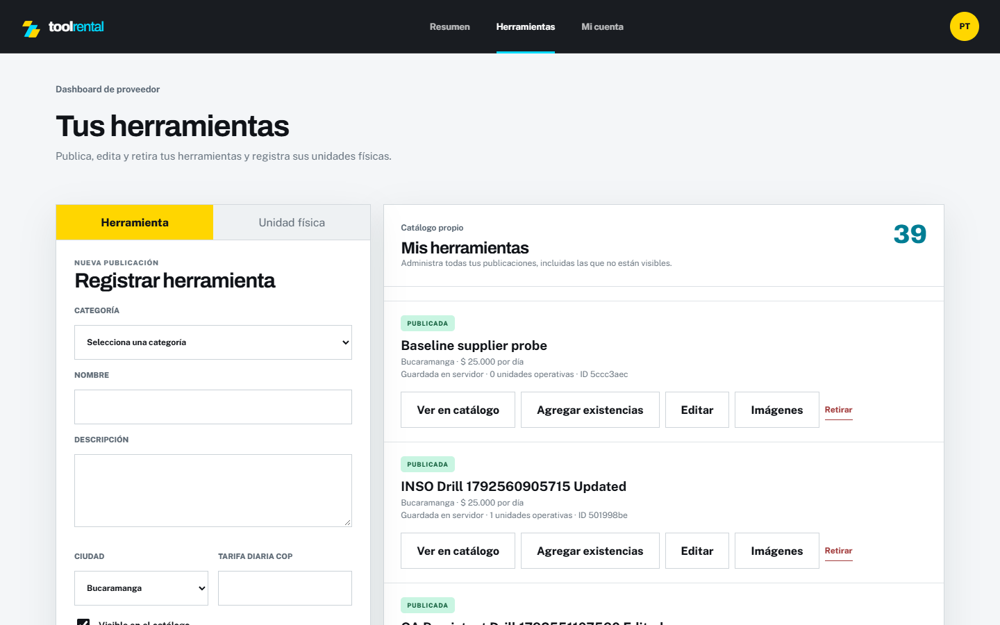
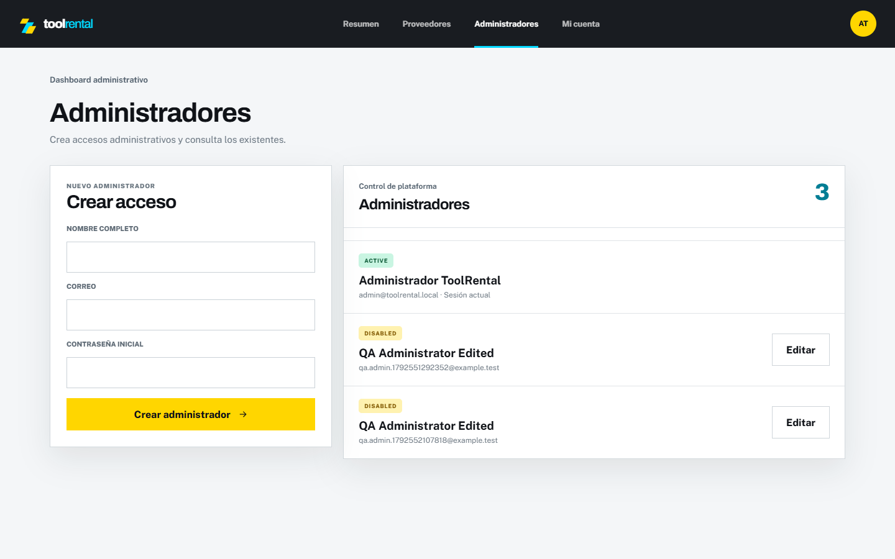
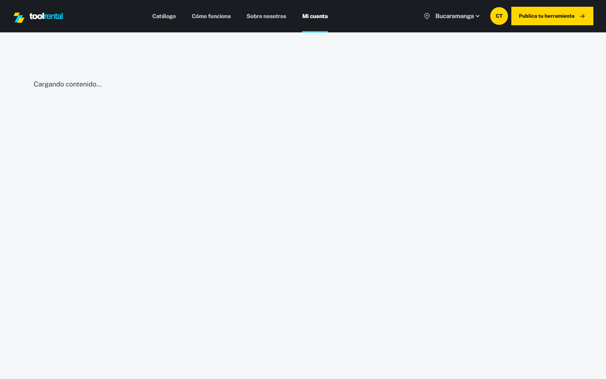
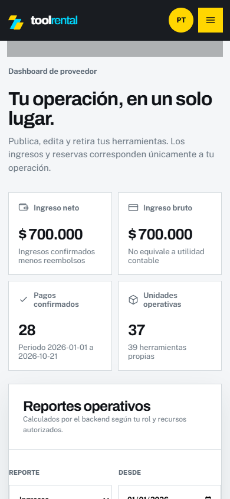

# Integración del header y seguridad del login

## Alcance

Integración de `developer/daniel-experiments` hasta `2566790`, realizada en `developer/daniel` y destinada a `develop`. La rama aportó el refinamiento visual y el dashboard dentro del header. Se conservaron Java 21, Tomcat integrado, PostgreSQL, los tres módulos y las reglas comerciales existentes. No se modificaron migraciones ni datos de negocio.

## Navegación conservada por rol

| Rol | Header con sesión | Operación conservada |
| --- | --- | --- |
| Cliente (`CUSTOMER`) | Catálogo, Cómo funciona, Sobre nosotros y Mi cuenta | Consultar disponibilidad, reservar, pagar y consultar su historial |
| Proveedor (`SUPPLIER`) | Resumen, Herramientas y Mi cuenta | Publicar y administrar herramientas, imágenes y unidades propias; operar sus alquileres |
| Administrador (`ADMIN`) | Resumen, Proveedores, Administradores y Mi cuenta | Supervisar la plataforma y administrar cuentas según los permisos del backend |

Sin sesión no aparecen secciones administrativas. Si existen ambos roles de staff, la navegación conserva la prioridad de administrador. El menú decide qué mostrar; JWT, rol, propiedad y estado de negocio siguen validándose en el servidor. El catálogo conserva su acceso público por URL. [Contrato completo de navegación](role-navigation.md).

| Before | After | Why |
| --- | --- | --- |
| La sección activa podía conservar el estado previo al login | El header y el contenido leen la misma URL con `useSyncExternalStore` | Mantener selección correcta al autenticar, navegar y usar atrás/adelante |
| En móvil había pestañas dentro de la página además del menú del header | Las secciones se abren desde el header en todos los tamaños | Evitar navegación duplicada y conservar una sola entrada por sección |
| El retorno tras login aceptaba rutas con barras invertidas | Solo se admite una ruta del mismo origen, sin controles ni barras invertidas | Evitar destinos manipulados y errores de navegación después de autenticar |

## Cambios de seguridad

- Correo limitado a 320 caracteres, con validación de formato en backend y frontend. Se rechazan espacios internos, controles Unicode, caracteres invisibles de formato, ángulos, comillas dobles y barras invertidas. Se conservan direcciones habituales como `customer+tag@example.test`.
- Contraseñas verificadas con un máximo de **72 bytes UTF-8**, correspondiente al BCrypt existente. Se rechaza el carácter nulo. No se recortan ni normalizan las contraseñas ni se prohíben arbitrariamente símbolos, acentos o espacios válidos. El registro mantiene su mínimo de 12 caracteres; el login no impone una nueva longitud mínima sobre cuentas existentes.
- Mensaje genérico ante cuenta inexistente, contraseña equivocada o cuenta no activa. La ruta de cuenta inexistente también ejecuta una comprobación de hash ficticio para reducir la diferencia de coste respecto a una cuenta conocida. No se afirma tiempo de respuesta constante.
- Contador de intentos compartido entre los alias `/api/auth/login` y `/api/v1/auth/login`, separado del contador de renovación. Se mantiene 429 con `Retry-After`. El límite es por dirección remota y proceso; esta entrega no incorpora almacenamiento distribuido del contador.
- `LoginRequest.toString()` omite correo y contraseña. El access token sigue en memoria y las cookies, CSRF, rotación y revocación de sesiones mantienen su contrato.
- El formulario muestra errores antes de enviar contraseñas fuera del límite y deshabilita el envío mientras la petición está en curso. La validación de servidor permanece obligatoria aunque se omita la del navegador.

Los símbolos de una contraseña no deben filtrarse como si fueran código SQL o HTML. La comprobación de límites de BCrypt y la admisión de caracteres válidos siguen las guías de [almacenamiento de contraseñas](https://cheatsheetseries.owasp.org/cheatsheets/Password_Storage_Cheat_Sheet.html) y [autenticación de OWASP](https://cheatsheetseries.owasp.org/cheatsheets/Authentication_Cheat_Sheet.html).

## Validación crítica reproducible

Ocho pruebas Java aprobadas: tres de entradas/BCrypt/rate limit, una del caso de uso de autenticación y cuatro de arquitectura. También se ejecutaron Spotless, lint y build. Los recorridos de navegador usan el backend y PostgreSQL de la composición aislada, sin mocks de API. [Resultados fechados](evidence/header-integration/results.json).

```powershell
.\mvnw.cmd -pl infrastructure -am '-Dtest=AuthenticateUserSecurityTest,LoginInputSecurityTest,ArchitectureTest' '-Dsurefire.failIfNoSpecifiedTests=false' clean test
.\mvnw.cmd -pl application,infrastructure spotless:check
npm --prefix frontend run lint
npm --prefix frontend run build
docker compose --env-file .env.validation -f compose.validation.yml build backend frontend
docker compose --env-file .env.validation -f compose.validation.yml up -d
```

En otra terminal, desde `frontend/`:

```powershell
$env:LIVE_SYSTEM_TESTS = 'true'
$env:AUDIT_URL = 'http://localhost:15173'
npx playwright test tests/header-roles-live.spec.js --project=desktop
```

La prueba del proveedor incluye viewport móvil. Cada rol inicia sesión por la interfaz, comprueba su header y consulta un endpoint administrativo: administrador recibe 200, cliente y proveedor reciben 403; sin JWT recibe 401. El cliente tampoco puede abrir el dashboard administrativo. Se comprueban además entradas inválidas, rechazo de contraseña fuera del límite y respuesta genérica de credenciales. Las cuentas son las ficticias del seed local; los JWT no se guardan en la evidencia pública.

La web estable utiliza `localhost:5173` con API `localhost:8080`; la validación usa frontend/API del mismo origen `localhost:15173` y backend `18080`. Sus imágenes frontend deben construirse con los argumentos de su propia composición: el origen de API se incorpora durante el build. No intercambiar esas imágenes entre entornos.

## Evidencias de interfaz









La validación se limita a estos recorridos críticos y no constituye una auditoría de penetración completa ni una nueva regresión de todas las operaciones de alquiler y pagos. Las pruebas de sistema anteriores conservan su propia revisión y fecha en [pruebas del sistema](system-tests.md).
