# Modelos lógico y físico

## Fuentes diferentes para responsabilidades diferentes

El [modelo conceptual](conceptual-model.md) describe entidades y relaciones del negocio. El modelo relacional siguiente se genera desde las claves reales de PostgreSQL: no sustituye el conceptual ni identifica una tabla con un agregado independiente. La organización de paquetes mantiene la convención del proyecto de un contexto por tabla.

[Diagrama SVG ampliable](diagrams/relational-model.svg) · [PNG](diagrams/relational-model.png) · [Fuente Mermaid](diagrams/relational-model.mmd) · [DDL físico exportado](diagrams/physical-schema.sql)

PK indica clave primaria; FK indica referencia. Los extremos expresan obligatoriedad y máximo según nulabilidad y unicidad de la FK. Las restricciones parciales y reglas entre filas se consultan en el DDL y la auditoría; el diagrama no pretende expresarlas todas.

## Normalización y restricciones

La [explicación de 4FN](fourth-normal-form.md) conserva dependencias y descomposición. Imágenes y unidades, y líneas de reservas y facturas, permanecen separadas. Los documentos emitidos conservan sus datos históricos. Claves compartidas y compuestas se exportan sin convertirlas en identidades artificiales.

La [auditoría](evidence/mvp/database-audit.json) contiene columnas, claves, referencias, checks, índices, versiones Flyway y conteos. Incluye todas las columnas; la ausencia de una relación JPA no implica ausencia de FK SQL. No se modifican migraciones históricas para cambiar el modelo.

## Datos académicos

V302 añade 20 escenarios históricos completos de alquiler y 20 cancelaciones anticipadas con reembolso pendiente, más extensiones rechazadas. Los usuarios históricos nuevos están desactivados y las herramientas históricas no se publican. Sus imágenes usan referencias ficticias HTTP(S) reservadas; no son fotografías descargadas de terceros ni publicaciones activas.

Se exigen al menos 20 filas en las 20 tablas de negocio y asociaciones. Roles mantienen el vocabulario autorizado; sesiones y tokens se generan en pruebas reales; políticas y tarifas conservan versiones coherentes. Estas cinco excepciones están justificadas en la matriz. Un reembolso PENDING no acredita una transferencia y las facturas son exclusivamente académicas.

## Regeneración

Desde la raíz, con la base aislada activa y .env.validation privado:

~~~powershell
node scripts/audit-database.mjs
cd frontend
node scripts/render-relational-model.mjs
~~~

El render usa Mermaid 11.12.0 y Chrome mediante Playwright; requiere conexión para obtener la biblioteca. El DDL no contiene filas ni contraseñas. No se versionan dumps con datos.

## Factura anterior al alquiler

V210 hace que invoices.reservation_id referencie reservations, no rentals. El webhook aprobado emite la factura académica antes de iniciar el alquiler. Existe como máximo una factura por reserva; sus líneas e instantáneas siguen siendo históricas. El diagrama relacional exportado refleja la FK real; las ilustraciones conceptuales históricas no sustituyen el DDL vigente.

## Ampliación V304–V305

El DDL, Mermaid, SVG y PNG se regeneraron desde la base aislada con V305: 25 tablas, 149 restricciones y 66 índices. Las columnas del checkout y de las decisiones ficticias pertenecen a payments; no se añaden relaciones ni contextos. La tabla de migraciones demo contiene 58 versiones aplicadas.
