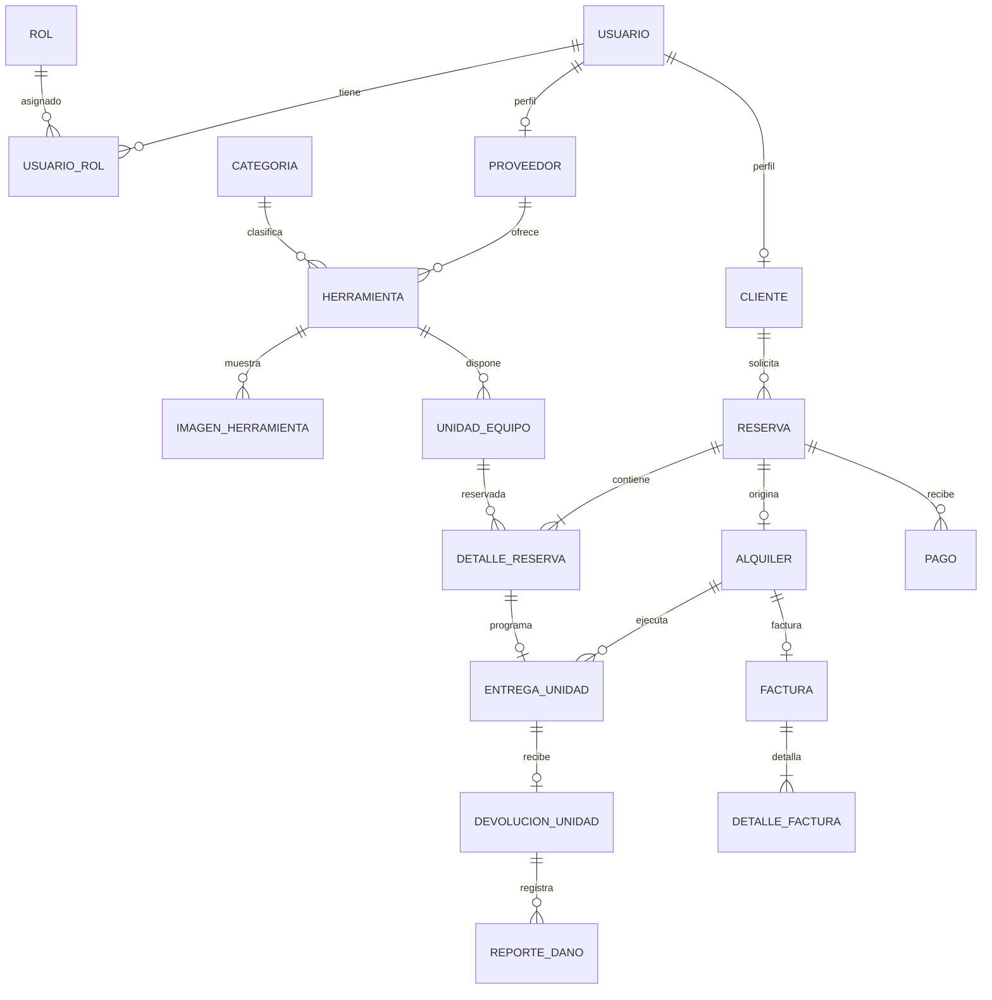

# Modelo conceptual — renta de herramientas

## Alcance y lectura del enunciado

Fuente: [ejercicioDemo.md](../ejercicioDemo.md). Esta primera entrega identifica conceptos, atributos, relaciones y reglas, y deriva un modelo lógico hasta 4FN. No implementa todavía Spring Boot, SQL, JWT, pagos, frontend ni despliegue. Los entregables del documento fuente son requisitos futuros del producto, no capacidades existentes.

El modelo conceptual expresa hechos del negocio; las claves foráneas, tablas y dependencias se presentan después en [normalización](normalizacion-4fn.md). Un panel, un CRUD, JWT, Swagger o una estadística no son por sí mismos entidades del negocio.

## Requisitos y conceptos detectados

| Fragmento o función del enunciado | Conceptos derivados |
| --- | --- |
| Registro de proveedores y clientes; perfiles Admin, Proveedor, Cliente | Usuario, Rol, Cliente, Proveedor |
| Inventario, categoría, descripción, imágenes, costos y estado | Herramienta, Categoría, ImagenHerramienta, UnidadEquipo |
| Seleccionar fechas; aceptar/rechazar solicitudes | Reserva, DetalleReserva |
| Historial de alquileres; entregar y devolver equipos | Alquiler, EntregaUnidad, DevoluciónUnidad |
| Reportar daños | ReporteDaño |
| Pagar en línea, validar pagos, descargar factura | Pago, Factura, DetalleFactura |

Las entidades asociativas UsuarioRol y DetalleReserva representan relaciones con identidad propia o compuesta. Administrador se representa como rol; no necesita una entidad con datos idénticos a Usuario.

## Supuestos de diseño que necesitan validación de negocio

1. Una cuenta puede tener varios roles independientes. Cliente y Proveedor son perfiles opcionales y compatibles de Usuario; una cuenta Admin puede no tener ninguno. Crear un perfil exige el rol correspondiente y retirar un rol no debe invalidar operaciones históricas.
2. Una herramienta es una oferta del catálogo de un proveedor, con una categoría principal. Cada unidad física tiene un código de inventario único dentro del proveedor. No se presupone que el número de serie sea universalmente único.
3. Las imágenes describen la oferta completa, no una unidad concreta. Sus imágenes y sus unidades físicas son conjuntos independientes. Si se necesitan fotos de daños o de unidades concretas, serán relaciones diferentes.
4. Una reserva contiene una o varias unidades concretas de un solo proveedor. Si el cliente selecciona equipos de varios proveedores, se generan reservas independientes. No se modela un carrito compartido entre proveedores.
5. Todas las líneas de una reserva comparten un intervalo `[inicio, fin)` y moneda. El alquiler se mide en días facturables según una política aún por acordar. La tarifa acordada por unidad se congela al confirmar; no cambia al editar la tarifa del catálogo.
6. Una reserva confirmada origina como máximo un alquiler. La reserva es la solicitud; el alquiler representa su ejecución, no una copia del inventario reservado.
7. Por cada unidad del alquiler hay como máximo una entrega y una devolución. Ambas pueden suceder en momentos distintos para cada unidad. Se permiten varios reportes de daño por devolución. No se contemplan sustituciones ni múltiples ciclos de entrega de una misma unidad dentro del mismo alquiler.
8. Se permiten varios intentos o pagos parciales por reserva. Cada pago pertenece a una sola reserva. No se almacena información de tarjetas. Reembolsos, pagos repartidos entre reservas y disputas quedan por definir.
9. Hay como máximo una factura por alquiler. Sus líneas y datos del emisor/receptor son hechos históricos inmutables al emitirla. No se definen todavía impuestos, notas crédito ni requisitos legales de facturación electrónica.
10. Los identificadores internos son estables. Los nombres, estados, direcciones y tarifas no identifican entidades. Las direcciones de entrega son un valor compuesto del evento, no un directorio de direcciones compartidas.

Estos supuestos permiten evaluar 4FN; modificar sus dependencias exige revisar el diseño. No se atribuyen al enunciado reglas que este no especifica.

## Entidades y atributos

Los identificadores son conceptuales; los tipos SQL y longitudes se decidirán al diseñar el modelo físico. `?` indica un atributo opcional; los demás son obligatorios salvo durante un borrador expresamente permitido.

| Entidad | Identidad | Atributos y significado |
| --- | --- | --- |
| Usuario | idUsuario; correo único | nombreVisible, correo, hashClave, estadoCuenta, fechaRegistro. La clave se representa mediante hash, nunca texto plano. |
| Rol | idRol; código único | código (`ADMIN`, `PROVEEDOR`, `CLIENTE`), descripción |
| UsuarioRol | usuario + rol | Asignación sin atributos adicionales; no almacena listas de roles. |
| Cliente | usuario | tipoPersona, tipoDocumento, númeroDocumento, nombreFacturación. Identidad documental única por tipo. |
| Proveedor | usuario | tipoDocumento, númeroDocumento, nombreComercial. Identidad documental única por tipo. |
| Categoría | idCategoría; nombre único | nombre, descripción? |
| Herramienta | idHerramienta | proveedor, categoría, nombre, descripción, tarifaDiariaActual, monedaTarifa, estadoPublicación |
| ImagenHerramienta | herramienta + URL | URL. Es una imagen del catálogo, independiente de sus unidades. |
| UnidadEquipo | idUnidad; proveedor + códigoInventario | herramienta, códigoInventario, númeroSerie?, condiciónActual, estadoOperativo. El proveedor se conoce por la herramienta. |
| Reserva | idReserva | cliente, creadaEn, inicio, fin, venceEn?, estadoReserva, moneda. Proveedor derivado de sus líneas. |
| DetalleReserva | reserva + unidad | tarifaDiariaAcordada. Cantidad implícita: una unidad física por línea. |
| Alquiler | reserva | iniciadoEn, estadoAlquiler. Identidad compartida con la reserva que lo origina. |
| EntregaUnidad | reserva + unidad | programadaEn, realizadaEn?, condiciónSalida?, direcciónEntrega (líneaDirección, ciudad, región, país). Relación con la línea y con el alquiler. |
| DevoluciónUnidad | reserva + unidad | recibidaEn, condiciónEntrada, observaciones? |
| ReporteDaño | idReporte | devolución afectada, registradoEn, descripción, estadoReporte, costoEvaluado? |
| Pago | idPago; procesador + referenciaExterna | reserva, procesador, referenciaExterna, importe, estadoPago, registradoEn, confirmadoEn?. Referencia presente desde el registro del intento. |
| Factura | idFactura; reserva única; número global único | alquiler, número, emitidaEn, estadoFactura, nombreEmisorEmitido, documentoEmisorEmitido, nombreReceptorEmitido, documentoReceptorEmitido. La numeración global es un supuesto técnico, pendiente de política fiscal. |
| DetalleFactura | factura + númeroLínea | descripciónEmitida, cantidad, precioUnitarioEmitido. Representa conceptos facturados históricos; no copia el nombre vivo de Herramienta. |

Las tarifas y pagos usan valores decimales exactos. En esta propuesta la moneda de los pagos y facturas se obtiene de la reserva; la tarifa del catálogo puede tener otra moneda y debe convertirse o rechazarse antes de acordar la tarifa de la línea. No se realiza conversión implícita.

## Relaciones, cardinalidad y participación

| Relación | Cardinalidad y participación |
| --- | --- |
| Usuario — Rol | N:M mediante UsuarioRol; ambos pueden tener 0..N asignaciones. Una cuenta activa debe tener al menos un rol (regla de aplicación). |
| Usuario — Cliente / Proveedor | Usuario tiene 0..1 de cada perfil; cada perfil pertenece exactamente a 1 Usuario. Especialización parcial y solapada. |
| Proveedor — Herramienta | Proveedor 0..N herramientas; herramienta exactamente 1 proveedor. |
| Categoría — Herramienta | Categoría 0..N herramientas; herramienta exactamente 1 categoría. |
| Herramienta — ImagenHerramienta / UnidadEquipo | Herramienta 0..N imágenes y 0..N unidades; cada una pertenece a exactamente 1 herramienta. |
| Cliente — Reserva | Cliente 0..N reservas; reserva exactamente 1 cliente. |
| Reserva — UnidadEquipo | N:M mediante DetalleReserva. Una reserva enviada tiene 1..N líneas; una unidad puede participar en 0..N reservas a lo largo del tiempo. |
| Reserva — Alquiler | Reserva 0..1 alquiler; alquiler exactamente 1 reserva. |
| DetalleReserva — EntregaUnidad | Línea 0..1 entrega; entrega exactamente 1 línea y 1 alquiler. |
| EntregaUnidad — DevoluciónUnidad | Entrega 0..1 devolución; devolución exactamente 1 entrega realizada. |
| DevoluciónUnidad — ReporteDaño | Devolución 0..N reportes; reporte exactamente 1 devolución. |
| Reserva — Pago | Reserva 0..N pagos; pago exactamente 1 reserva. |
| Alquiler — Factura | Alquiler 0..1 factura; factura exactamente 1 alquiler. |
| Factura — DetalleFactura | Factura emitida 1..N líneas; línea exactamente 1 factura. |

## Diagrama conceptual

Las entidades asociativas se hacen visibles para explicar los hechos que separan las relaciones. El diagrama es conceptual: no contiene columnas SQL ni claves foráneas.

Las cardinalidades mínimas 1 de líneas corresponden a reserva enviada y factura emitida; los borradores pueden tener 0. La condición «entrega realizada» requiere una regla adicional al vínculo del diagrama.

## Reglas e información derivada

- `inicio < fin`; importes no negativos y pagos estrictamente positivos. Una unidad no puede estar comprometida por dos reservas vigentes con intervalos que se solapen. En reservas confirmadas, `[inicio, fin)` permite devolver e iniciar otra reserva en el mismo instante límite.
- La disponibilidad para un período se calcula con reservas que bloquean inventario, vencimientos, estado operativo y alquileres aún sin devolución. Una devolución tardía exige bloquear nuevas entregas hasta resolverla. No es un booleano global ni solo una propiedad del catálogo.
- Todas las líneas de una reserva deben pertenecer al mismo proveedor. La propiedad de una herramienta no cambia mientras haya compromisos; después, una transferencia necesitaría un modelo histórico específico.
- Las líneas, fechas y moneda se congelan al confirmar la reserva. El detalle del alquiler se obtiene de ellas, sin duplicarlo. La creación del alquiler requiere confirmación; una devolución requiere una entrega realizada. No se borran equipos, personas ni documentos referenciados por operaciones históricas: se inactivan.
- Historiales, paneles e ingresos se consultan a partir de operaciones. Los ingresos cobrados se calculan con pagos confirmados; facturado y cobrado son métricas distintas.
- Total estimado de reserva: suma de tarifa acordada por días facturables. Total básico de factura: suma de cantidad por precio unitario emitido. Saldo: obligación definida menos pagos confirmados; la política de recargos/impuestos está pendiente. No almacenar estos valores derivados en el modelo normalizado inicial.
- Los estados necesitan transiciones de negocio, no solo cadenas válidas. Aceptación por proveedor y confirmación de pago aparecen con distinto orden en el enunciado; su secuencia exacta debe acordarse antes de implementar.

## Orientación posterior para DDD y arquitectura hexagonal

Posibles módulos: identidad, catálogo/inventario, reservas/alquileres y cobros/facturación. Las entidades conceptuales no equivalen automáticamente a agregados DDD ni a clases JPA. Límites de transacción, puertos y agregados se definirán al implementar las reglas; pagos externos y almacenamiento de imágenes serán adaptadores. Esta organización es una propuesta, no una arquitectura ya implementada.
