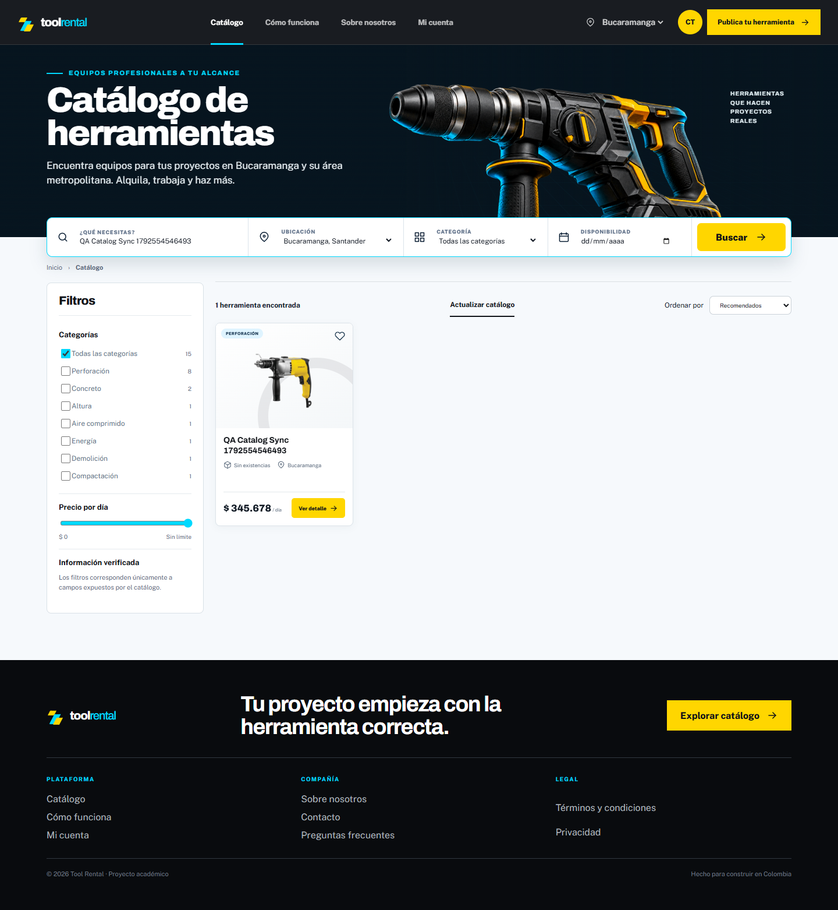
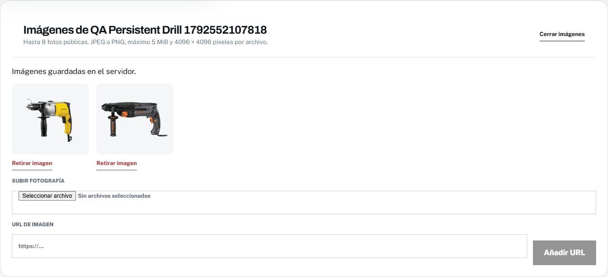
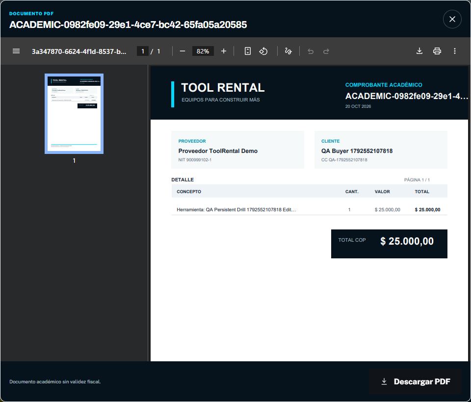
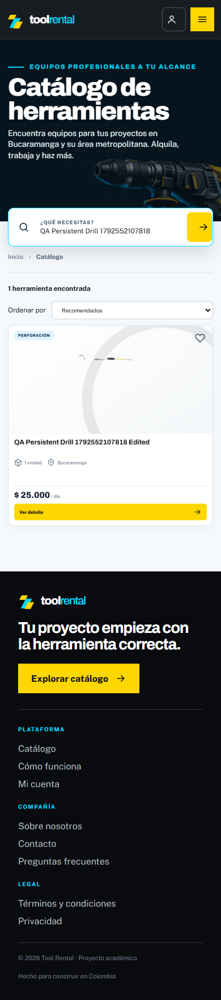

# Gestión del proveedor y persistencia verificada

## Resultado y límites

La creación de herramientas ya respondía HTTP 201 en la reproducción inicial con servicios reales. Faltaban la gestión visual de imágenes, la republicación directa y una carga independiente del inventario: un fallo de reportes podía ocultar la administración. Se añadieron estas capacidades y se verificaron operaciones de los tres roles.

| Antes | Después | Motivo |
| --- | --- | --- |
| Fotos siempre vacías en el formulario | Archivos y URLs con vista previa y retirada | Completar las publicaciones sin depender de recursos precargados. |
| Retirar sin acción directa inversa | Publicar y retirar con respuesta persistida | Evitar estados aparentes mantenidos solo en React. |
| Reportes e inventario fallan juntos | Cargas independientes y reintento | Mantener disponibles las herramientas aunque falle un reporte. |
| Una carga tardía puede sobrescribir el perfil editado | Edición habilitada después de cargar los datos del servidor | Impedir que se guarde accidentalmente el valor anterior. |
| Creación administrativa en varias peticiones | Cuenta, rol y perfil en una transacción | Evitar cuentas incompletas si falla una restricción SQL. |

La arquitectura conserva Java 21, tres módulos, 25 contextos y 25 tablas. No se modificaron migraciones aplicadas ni se crearon tablas para los archivos.

## Uso del panel

1. Ingresa como proveedor y abre **Dashboard → Herramientas**.
2. Completa categoría, nombre, descripción, municipio, tarifa y visibilidad; pulsa **Crear herramienta**.
3. Se abre la sección de imágenes de la herramienta guardada. Puedes subir JPEG/PNG o añadir una URL HTTP(S).
4. Cada herramienta ofrece **Editar**, **Imágenes** y **Publicar/Retirar**. Retirar conserva sus datos e historial.
5. Usa **Unidad física** para registrar existencias. La lista inferior permite editar serial, condición y estado operativo. Una unidad retirada definitivamente no admite reactivación.

Publicar una herramienta no inventa existencias. La disponibilidad depende de sus unidades operativas y de las reservas; una publicación sin unidades no puede reservarse.

## Base estable y DBeaver

### Corrección de visibilidad y sincronización del catálogo

La revisión del 20 de octubre de 2026 encontró **52 herramientas guardadas, 32 publicadas, 26 asociaciones de imágenes y 51 unidades** en la base estable. Las dos publicaciones nuevas del usuario ya estaban persistidas. DBeaver consultaba otra instancia de PostgreSQL y la interfaz añadía un filtro de precio implícito.

| Antes | Después | Motivo |
| --- | --- | --- |
| Límite inicial de $230.000 por día | Sin límite inicial; control de precio con rango calculado del catálogo | Mostrar también las publicaciones de $234.567 y $245.678 que ya estaban guardadas. |
| Consulta única al abrir la aplicación | Revalidación al navegar al catálogo, recuperar foco, regresar a una pestaña visible y cada 30 segundos mientras esté visible | Recibir publicaciones de otros proveedores sin recargar toda la aplicación. |
| Cambios del proveedor sin invalidación | Señal local después de operaciones exitosas y aviso entre pestañas mediante un marcador sin datos personales | Actualizar nombres, fotos, publicación y existencias. |
| Fallo de API que puede mostrar una muestra | Error explícito con reintento; se conserva la última lectura válida y se advierte que puede estar desactualizada | Evitar confundir contenido de demostración con datos persistidos. La muestra exige `VITE_DEMO_MODE=true`. |
| DBeaver conectado solamente a `localhost:5432` | Conexión adicional **Tool Rental - Docker 5433** a la misma base de la web | Consultar los datos correctos sin cambiar conexiones de otros proyectos. |
| URL privada del backend nativo diferente de Docker | `DB_URL` privado alineado con el puerto 5433 y la base estable | Mantener los mismos datos al ejecutar desde Spring Boot Dashboard con `.env`. |

La actualización mantiene búsqueda, categoría, municipio y restricciones de precio elegidas por el usuario. **Actualizar catálogo** permite consultar inmediatamente; también existe **Reintentar conexión** si falla la API. La revalidación periódica no es una conexión WebSocket ni garantiza actualización instantánea entre equipos.

El municipio sigue siendo un filtro real: una publicación de Floridablanca no aparece al seleccionar Bucaramanga. El mensaje de resultados vacíos lo explica. Una publicación sin unidades aparece como **Sin existencias** y no puede reservarse; registrar una herramienta y registrar sus unidades físicas son pasos diferentes.

### Inicio local con datos semilla

El perfil `local,demo` aplica las migraciones de estructura y `db/demo` automáticamente mediante Flyway sobre una base vacía. Incluye cuentas por rol, catálogo y escenarios históricos; las pruebas de integración verifican al menos 20 registros por tabla de negocio y 65 migraciones hasta V308. No es necesario ejecutar INSERT manuales ni volver a cargar el seed en cada inicio.

```powershell
# Desde la raíz real Tool-rental-platform, con .env privado ya configurado:
docker compose up --build -d
node scripts/verify-local-catalog.mjs
```

En otra instalación, copia primero `.env.example` a `.env`, configura sus credenciales locales y conserva `SPRING_PROFILES_ACTIVE=local,demo`, `POSTGRES_PORT=5433`, `VITE_DEMO_MODE=false` y `VITE_REQUIRE_LIVE_API=true`. La base de ejemplo se llama `tool_rental`; en el equipo de Daniel se conserva `tool_rental_demo_conde_mvp` con sus datos existentes. No cambies `POSTGRES_DB` de un volumen ya inicializado esperando que PostgreSQL cree otra base automáticamente.

Spring Boot Dashboard debe cargar `.env` mediante el `envFile` del lanzamiento de VS Code y usar `DB_URL=jdbc:postgresql://localhost:5433/tool_rental_demo_conde_mvp` en este equipo. Para ejecutar Java desde el IDE, detén antes solo el backend de Docker con `docker compose stop backend` y libera el puerto 8080; conserva PostgreSQL y frontend. Si utilizas otra consola, exporta las variables explícitamente: Spring Boot no lee `.env` por sí solo. La comprobación `verify-local-catalog.mjs` también detecta diferencias entre la URL nativa y la configuración de Docker.

`docker compose down` conserva los volúmenes. **No uses `docker compose down -v` para actualizar**, porque elimina tanto los datos como las fotografías subidas. El perfil demo es exclusivamente local/académico; las cuentas conocidas del seed no son accesos de producción.

### Comprobación desde DBeaver

La conexión adicional está guardada y PostgreSQL confirmó sesiones de DBeaver en la misma base que utiliza Spring Boot. Se abrió [verify-local-persistence.sql](../scripts/database/verify-local-persistence.sql) para consultar base, conteos, publicaciones, imágenes, unidades y migraciones, sin leer contraseñas ni tokens.

Selecciona **Tool Rental - Docker 5433**, abre sus tablas del esquema `public` y actualiza la vista de datos con **F5** después de una operación web. DBeaver no actualiza automáticamente una cuadrícula SQL ya consultada. `inet_server_port()` devuelve 5432 dentro del contenedor; el puerto de acceso desde Windows es 5433.

La conexión se añadió con la [CLI oficial de DBeaver](https://dbeaver.com/docs/dbeaver/Command-Line/), con credenciales procedentes de un archivo temporal privado ignorado, sin incluir la contraseña en argumentos ni modificar la conexión del puerto 5432. El archivo temporal se retiró después de guardar la conexión en DBeaver.

### Evidencias de esta corrección

El [cruce de PostgreSQL y API](evidence/catalog-sync/database.json) verifica que todas las publicaciones, precios y cantidades de imágenes coinciden. La [prueba Playwright con proveedor y cliente reales](evidence/catalog-sync/browser.json) crea una publicación de $345.678 con fotografía y comprueba su llegada a un catálogo previamente abierto. Las escrituras de prueba se hicieron exclusivamente en la base aislada, conservando la base estable.

El [registro SQL de la publicación](evidence/catalog-sync/created-tool.json) y la [verificación posterior al reinicio](evidence/catalog-sync/restart.json) confirman que precio e imagen se conservan. La [revisión de la web estable](evidence/catalog-sync/stable-browser.json) verifica mediante lecturas las dos publicaciones del usuario por encima del antiguo límite.

La [validación de esta corrección](evidence/catalog-sync/validation.json) registra **112 pruebas Java aprobadas**, **94 pruebas de navegador aprobadas y dos omisiones por dispositivo**, lint, build y ambas configuraciones Compose. Las regresiones cubren precios altos, foco, navegación, invalidación entre pestañas, actualización periódica y fallo/reintento sin perder la lectura anterior. Se sustituyó la expectativa antigua de mostrar datos ficticios al fallar la API y se asignó un presupuesto de 90 segundos a la prueba que realiza cinco auditorías axe completas, conservando todas sus verificaciones.



Los resultados corresponden a la fecha registrada en cada evidencia; los conteos pueden cambiar al continuar utilizando la aplicación.

La aplicación habitual utiliza `tool_rental_demo_conde_mvp` en PostgreSQL Docker. La configuración privada queda en `.env`, ignorado por Git, con `POSTGRES_PORT=5433`, la base acordada y perfiles `local,demo`. El PostgreSQL local del puerto 5432 permanece separado.

En DBeaver utiliza host `localhost`, puerto `5433`, base `tool_rental_demo_conde_mvp` y el usuario/contraseña privados de `.env`. No conectes al puerto interno del contenedor desde Windows.

```powershell
docker compose up --build -d
Invoke-RestMethod http://localhost:8080/status/database
```

La web queda en http://localhost:5173. Se desactiva el reemplazo silencioso del catálogo por datos demo cuando falle la API.

Ejemplo de comprobación SQL, sin consultar contraseñas ni tokens:

```sql
SELECT tool_id, supplier_id, name, publication_status, service_city FROM tools ORDER BY name;
SELECT tool_id, image_url FROM tool_images;
SELECT equipment_unit_id, tool_id, inventory_code, operational_status FROM equipment_units;
```

Las pruebas mutantes se ejecutan en `mvp_supplier_20261020`, una base aislada del proyecto `tool-rental-mvp`, accesible mediante http://localhost:15173. Los registros QA de esa base no se copiaron a la base estable.

## Imágenes y almacenamiento

Usa fotografías propias o con permiso de uso, con la herramienta completa y sin datos personales identificables. Estas condiciones consolidadas sustituyen la guía anterior de entrega de fotografías del catálogo.

- Máximo 8 imágenes por herramienta. Archivos JPEG/PNG de hasta 5 MiB, máximo 4096 × 4096 píxeles.
- Validación por contenido real, reescritura sin metadatos, sin cambiar dimensiones. JPEG utiliza calidad máxima del codificador.
- Los enlaces externos admiten HTTP(S), sin credenciales en la URL. El backend no los descarga ni los copia.
- PostgreSQL guarda las asociaciones en `tool_images`; los bytes de archivos propios viven en el volumen `tool_images` (validación: `mvp_tool_images`).
- Las referencias propias son relativas y estables: `/api/v1/public/tool-images/files/{uuid}.png|jpg`. El frontend resuelve el origen de la API, tanto directo como detrás del proxy.
- Los archivos son fotografías públicas de catálogo; no deben contener documentos privados. La modificación exige sesión activa y propietario o administrador.
- Los nombres originales no se usan como rutas. Se rechazan formatos ajenos, rutas arbitrarias y enlaces con esquemas ejecutables.
- Si falla la transacción de subida, se elimina el archivo recién generado. Un recolector reintenta limpiar archivos no asociados y temporales con más de 24 horas; no elimina URLs externas.

## Contratos añadidos

| Método y ruta `/api/v1` | Entrada / resultado |
| --- | --- |
| `PATCH /tools/{id}/publication` | `{ "published": true|false }`; devuelve la herramienta guardada. |
| `GET /tools/{id}/images` | Imágenes del recurso propio, también accesibles al administrador. |
| `POST /tools/{id}/images` | Multipart con campo `file`; devuelve `toolId` e `imageUrl`. |
| `GET /public/tool-images/files/{filename}` | Bytes con tipo JPEG/PNG y `nosniff`. |
| `POST /suppliers/accounts` | Alta administrativa atómica de usuario, rol SUPPLIER y perfil. |
| `POST /users/administrators` | Alta administrativa atómica de usuario y rol ADMIN. |

Se conservan `POST /tool-images`, `DELETE /tool-images/entry`, edición de herramientas/unidades y alias legado `/api`. La asociación manual de una referencia propia está prohibida: debe originarse en la subida de esa herramienta.

Los errores mantienen `ProblemDetail`: 400 entrada inválida, 401 sin sesión, 403 sin permiso, 404 ausente, 409 conflicto, 413 archivo demasiado grande y 503 almacenamiento no disponible.

## Evidencias y reproducción

La validación automatizada incluye **112 pruebas Java** (27 Domain, 16 Application y 69 Infrastructure), PostgreSQL/Testcontainers y formato. El frontend pasa lint, build y **84 pruebas de navegador**, con dos omisiones previstas por dispositivo. [Resumen y huellas de los reportes](evidence/provider-persistence/validation.json).

El [resultado Playwright CLI](evidence/provider-persistence/site-persistence.json) registra **67 comprobaciones** con React, Spring Boot y PostgreSQL reales, sin interceptar la API. El snapshot SQL verifica el estado final de las operaciones; las respuestas HTTP y las lecturas posteriores comprueban las transiciones intermedias. No se presenta cada transición como una consulta SQL independiente.

| Rol | Recorridos comprobados | Tablas principales |
| --- | --- | --- |
| Proveedor | Crear, editar, retirar, republicar; subir/retirar fotos y URLs; registrar y actualizar unidades | `tools`, `tool_images`, `equipment_units` |
| Cliente | Registro, perfil, contraseña, reserva, cinco pagos ficticios, comprobante, cancelación y solicitud de extensión | `users`, `customers`, `user_roles`, `user_sessions`, `reservations`, `reservation_items`, `payments`, `invoices`, `invoice_items`, `reservation_terminations`, `reservation_extensions` |
| Proveedor operativo | Entrega, alquiler, devolución, cierre, aprobación REST de extensión y cinco consultas de reportes | `unit_deliveries`, `rentals`, `unit_returns`, `reservation_extensions` |
| Administrador | Crear/editar/desactivar proveedores y administradores, con sus roles | `users`, `suppliers`, `user_roles` |

La aprobación de extensión se comprobó mediante REST porque la interfaz vigente no ofrece ese control; no se presenta como recorrido visual. Los reportes son consultas, no escrituras. La prueba no añade funcionalidades ajenas a los formularios vigentes ni certifica escenarios comerciales no recorridos.

```powershell
node frontend/scripts/verify-site-persistence.mjs
node scripts/verify-persistence-backup.mjs
```

El segundo comando utiliza exclusivamente `.env.validation`. Restaura PostgreSQL en otra base, extrae los archivos en otro volumen y compara conteos y hashes. Después recrea la composición aislada conservando sus volúmenes y verifica JDBC, catálogo y archivos mediante HTTP. Consulta [el resultado del respaldo](evidence/provider-persistence/backup-restore.json).

Los archivos privados del respaldo quedan bajo `backups/`, ignorado por Git. En publicación, `scripts/backup.sh` toma conjuntamente base y fotos durante una breve parada del backend, reanuda el servicio y copia el paquete al destino externo antes de aplicar retención. La transferencia externa y Oracle siguen pendientes; la restauración validada aquí es local.

## Capturas






