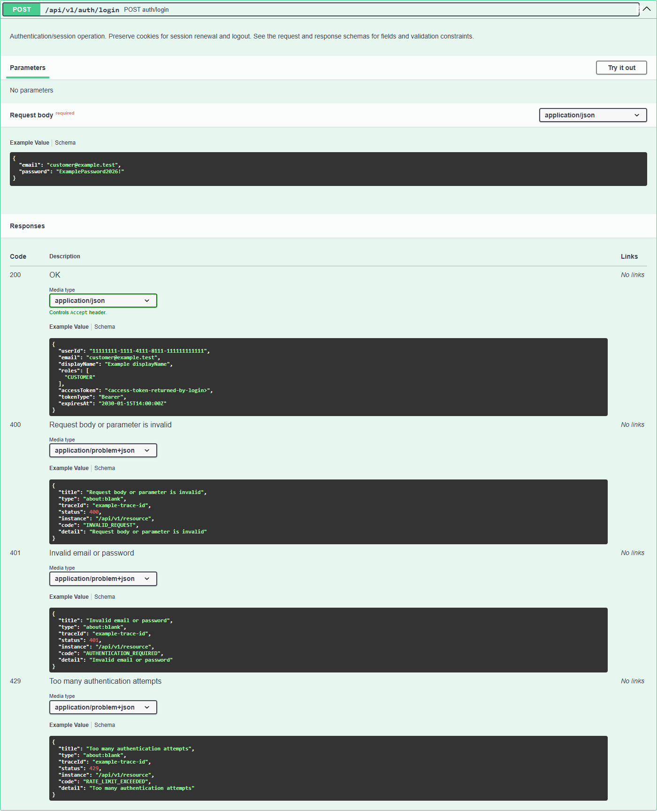

# Pruebas del sistema: API, Insomnia y Tomcat

Verificación local del **21 de octubre de 2026**. Se completaron los ejemplos de Swagger y se añadió una colección ejecutable de Insomnia. Los resultados corresponden a servicios HTTP y PostgreSQL reales; los pagos son ficticios por la decisión vigente del MVP.

## Cumplimiento del entregable

| Requisito | Resultado | Evidencia |
| --- | --- | --- |
| Listado de endpoints, peticiones y respuestas | Swagger publica 92 rutas y 123 operaciones versionadas, con resúmenes, descripciones y esquemas | [Swagger local](http://localhost:8080/swagger-ui/index.html), [auditoría de OpenAPI](evidence/system-tests/openapi.json) |
| Ejemplos JSON | Ejemplos explícitos de peticiones y respuestas JSON; los PDF y las respuestas sin cuerpo conservan su contrato | Misma auditoría; expandir una operación en Swagger |
| Autenticación JWT | Instrucciones de login, Authorize, expiración, renovación, CSRF y revocación en Swagger | [Contrato REST](rest-api.md#autenticación-y-sesiones) |
| POST, GET, PUT y DELETE | Ejecutados mediante Insomnia contra el backend aislado | [Colección importable](insomnia/system-tests.json), [resultado](evidence/system-tests/insomnia.json) |
| JWT y protección de rutas | 401 sin JWT, JWT inválido y sesión revocada; 403 por rol, propiedad y CSRF | Mismo resultado |
| Alquiler y pagos | Aprobación, reintento, comprobante único, entrega, alquiler, devolución y cierre; rechazo y liberación de disponibilidad | Resultado de Insomnia y [consulta directa de PostgreSQL](evidence/system-tests/persistence.json) |
| Apache Tomcat embebido | Tomcat **10.1.55**, Java 21, arranque con `java -jar` y conexión JDBC activa | [Comprobación del contenedor](evidence/mvp/tomcat-runtime.json) |

Se ejecutó **Kong Inso CLI 13.3.1**, la herramienta oficial de automatización de Insomnia: **41 peticiones y 61 comprobaciones aprobadas**. No se afirma haber ejecutado la colección en la interfaz gráfica de Insomnia. El archivo permite importarla y repetirla allí para la presentación.

## Consultar y utilizar Swagger

1. Iniciar el entorno estable con `docker compose up --build -d`.
2. Abrir [Swagger UI](http://localhost:8080/swagger-ui/index.html). El [OpenAPI JSON](http://localhost:8080/v3/api-docs) contiene el listado completo y es importable en clientes de API.
3. Expandir `POST /api/v1/auth/login` y usar **Try it out** con una cuenta local del seed. Ejemplo exclusivamente local:

```json
{
  "email": "cliente@toolrental.local",
  "password": "ToolRental2026!"
}
```

4. Copiar el `accessToken` devuelto y pegar **solo ese valor** en **Authorize**. Swagger envía `Authorization: Bearer <token>`.
5. Consultar una operación privada. Cambiar de rol requiere obtener el token de la cuenta correspondiente; el backend conserva los controles de propiedad.

La respuesta de login incluye `userId`, `email`, `displayName`, `roles` (arreglo), `accessToken`, `tokenType` y `expiresAt`. Los valores de **Example Value** son ilustrativos, no credenciales ni identificadores existentes: sustituir UUID, fechas y referencias por los obtenidos del entorno.

Para renovar o cerrar sesión, conservar la cookie HttpOnly `trp_refresh`. Antes, consultar `GET /api/v1/auth/csrf`, conservar su cookie `XSRF-TOKEN` y enviar el **token de la respuesta JSON** en `X-XSRF-TOKEN`. No sustituir el valor de la cookie por el token JSON: Spring puede devolverlo en una representación enmascarada. El access token dura 15 minutos; renovar rota la cookie y cerrar sesión revoca el acceso inmediatamente.




## Repetir las pruebas en Insomnia

### Entorno aislado obligatorio

Las pruebas escriben datos y crean sesiones. Se ejecutan únicamente en `http://localhost:18080`, servido por `compose.validation.yml`, con PostgreSQL exclusivo. Una protección previa en cada petición rechaza otro host o puerto, incluido el backend de trabajo `8080`. No se debe retirar esa protección para probar sobre la base del usuario o una publicación pública.

Preparar las variables privadas de `.env.validation` siguiendo [despliegue](deployment.md). Arrancar:

```powershell
docker compose --env-file .env.validation -f compose.validation.yml up --build -d
```

El perfil `local,demo` debe contener las cuentas locales `proveedor@toolrental.local` y `cliente@toolrental.local`, con la contraseña académica incluida en la colección. No utilizar esas credenciales en un entorno público.

### Cliente gráfico

1. En Insomnia, elegir **Import → File** y seleccionar [system-tests.json](insomnia/system-tests.json), exportación portable v4.
2. Abrir **Tool Rental - System Acceptance** y su entorno base.
3. Ejecutar las 41 peticiones **en orden**, mediante Collection Runner. No ejecutar en paralelo: cada paso usa identidades del anterior.
4. Revisar los resultados de los scripts de respuesta. El resultado esperado es 61 comprobaciones aprobadas.

La colección captura JWT, cookies e identidades automáticamente en variables del entorno de ejecución. Gestiona las cookies explícitamente para separar las sesiones de cliente y proveedor. El archivo versionado contiene los tokens vacíos; no exportar nuevamente el entorno con credenciales o sesiones activas.

### Automatización reproducible con Inso CLI

Instalar el binario oficial de [Inso CLI](https://developer.konghq.com/inso-cli/) y disponer de Node.js. Para esta evidencia se verificó el SHA-256 del binario Windows de la versión 13.3.1 contra su publicación oficial. No se añadió como dependencia del producto.

```powershell
# Omitir INSO_BIN si inso ya está en PATH.
$env:INSO_BIN = 'C:\tools\inso.exe'
node scripts/verify-system-tests.mjs
node scripts/verify-system-persistence.mjs
node scripts/verify-system-openapi.mjs
node scripts/verify-tomcat.mjs
```

La primera instrucción ejecuta realmente la colección con `inso run collection`. El informe público conserva únicamente nombres de casos, estados HTTP, duración y resultados. Los archivos de trabajo quedan bajo `backups/`, ignorado por Git; sus logs pueden contener cookies, por lo que no deben compartirse. No se activa `--includeFullData`.

Para regenerar la colección desde su fuente: `node scripts/generate-insomnia-system-tests.mjs`. Cada ejecución crea una herramienta e inventario con un nombre único `INSO-…`; conserva estos datos como evidencia en la base aislada. Repetir no limpia ni modifica la base de trabajo.

## Casos ejecutados

| Grupo | Operaciones y comprobaciones |
| --- | --- |
| Catálogo y CRUD | GET público; login proveedor; POST herramienta; PUT edición; GET que conserva la edición; DELETE que retira la publicación; GET público 404 y GET privado que conserva historial; republicación y POST unidad física |
| Autorización | 401 sin credencial y con JWT inválido; cliente recibe 403 al listar usuarios administrativos o modificar una herramienta ajena |
| Reserva y pago aprobado | Reserva de un día inclusivo con precio calculado por servidor; conflicto 409 al solapar la unidad; checkout con Idempotency-Key; reintento devuelve el mismo pago; aprobación duplicada conserva una sola factura |
| Operación del alquiler | PDF del comprobante; entrega programada y completada; alquiler ACTIVE; devolución; cierre y lectura COMPLETED |
| Pago rechazado | Segundo checkout; decisión DECLINED; reserva PAYMENT_FAILED; unidad nuevamente disponible para ese intervalo |
| Sesión | CSRF inicial; renovación sin cabecera 403; renovación válida con rotación; logout 204; el token de esa sesión pasa a responder 401 |

**DELETE de herramientas es una retirada lógica**, no una eliminación física: evita perder referencias e historial. La consulta PostgreSQL de la última ejecución confirma una herramienta, una unidad, dos reservas (`CONFIRMED` y `PAYMENT_FAILED`), dos pagos (`CONFIRMED` y `FAILED`), un comprobante, un alquiler completado, una entrega realizada y una devolución.

## Tomcat y alcance de la validación

El [Dockerfile](../Dockerfile) empaqueta un JAR Spring Boot con Java 21. `spring-boot-starter-web` aporta Apache Tomcat integrado y el contenedor ejecuta `java -jar infrastructure-0.1.0-SNAPSHOT.jar`. No se requiere WAR ni instalación independiente de Tomcat para el requisito acordado. El backend estable atiende en [localhost:8080](http://localhost:8080); el aislado en `18080`. [Procedimiento de despliegue](deployment.md#apache-tomcat-integrado).

Se ejecutaron [dos pruebas focalizadas del personalizador OpenAPI](evidence/system-tests/openapi-unit.json), compilación y formato del backend, las 41 peticiones de Insomnia, lectura SQL de persistencia y verificación visual de Swagger. No se ejecutó una nueva regresión completa `clean verify` ni se acredita cobertura de las 123 operaciones: la aceptación cubre los recorridos críticos detallados arriba.

Esta entrega demuestra funcionamiento local del entregable. No acredita publicación Oracle/HTTPS, pagos reales, pasarela oficial ni recuperación por correo. Se mantienen las decisiones y bloqueos descritos en [MVP](mvp.md).

Referencias de la herramienta: [ejecución de colecciones](https://developer.konghq.com/inso-cli/reference/run_collection/), [importación y exportación](https://developer.konghq.com/insomnia/import-export/) y [scripts de Insomnia](https://developer.konghq.com/insomnia/scripts/).
